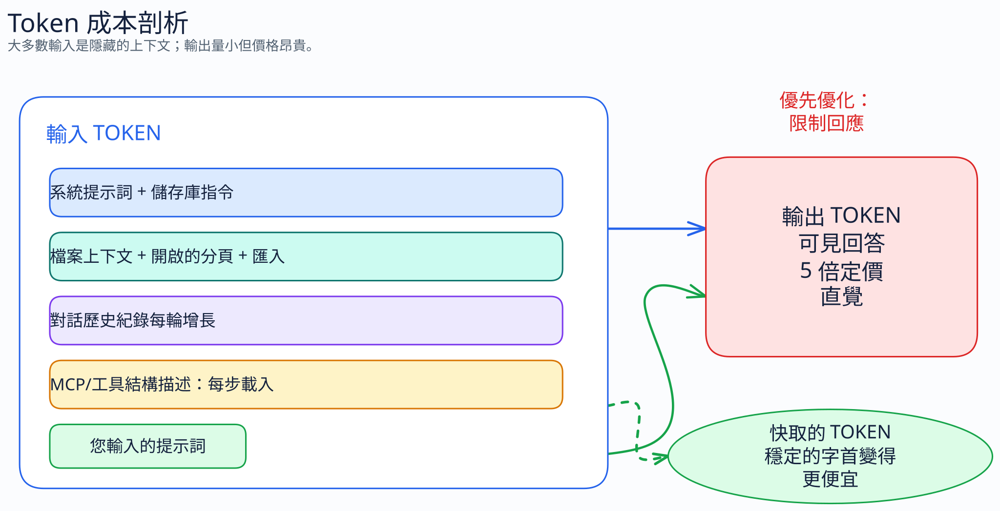

# 第 1 部分：為什麼 Token 很重要

[← 返回指南](index.md)

---

## 1.1 什麼是 Token？

大型語言模型讀取與寫出的單位是 token。一個 token 可以代表一個單字、單字的一部分或標點符號。位元組對編碼（Byte-Pair Encoding，BPE）會從反覆出現的位元組序列建立這些單位。

### BPE 的運作方式

1. 從原始位元組開始（256 種可能的值）
2. 找出訓練資料中最常出現的位元組對
3. 將這些位元組對合併為新的 token
4. 重複上述步驟，直到詞彙表達到目標大小（大小會因 tokenizer 而異）

常見單字可能成為單一 token；罕見或較長的單字通常會被拆成多個片段。

### 範例

| 文字 | Token | 數量 |
|------|--------|-------|
| `hello` | `hello` | 1 |
| `unhappiness` | `un` + `happiness` | 2-3 |
| `authentication` | `authentication` | 2-3 |
| `I met a huge dog` | `I` `met` `a` `huge` `dog` | 5 |
| `Sure, I'd be happy to help you with that!` | （每個單字／標點符號） | ~10 |

這些是示意性的切分，並非每個 tokenizer 的精確數量。最後一個範例把 token 花在開場白上，卻沒有回答問題。

在 Claude 3 tokenizer 中，最常見的 10,000 個英文單字裡，有 8,311 個會被切成單一 token。常見單字單獨看很便宜，但不必要的字詞累積起來仍然可觀。

## 1.2 為什麼你應該關心

Token 用量會影響成本、限制、容量與速度：

| 面向 | 影響 |
|-----------|--------|
| **成本** | API 定價以 token 計算，GitHub Copilot 的使用限制也以 token 為基礎。在 Anthropic 的範例中，**輸出每個 token 的成本是輸入的 5 倍**：每 MTok，Haiku 為 $1/$5，Sonnet 為 $3/$15，Opus 為 $5/$25。Copilot UBB 也會區分不同的 token 類別；在將廠商費率套用到 Copilot 支出之前，請先參閱[模型選擇與定價](11-models-and-pricing.md) |
| **速率限制** | 當 token 型限制是瓶頸時，減少 token 會有幫助；請求型限制仍然適用 |
| **上下文視窗** | 輸入與輸出共用有限的空間。不必要的輸入會讓有用的上下文或輸出可用的空間變少 |
| **速度** | 較少的輸入可縮短首個 token 的等待時間；快取與模型行為也有影響 |
| **計費** | 自 2026 年 6 月 1 日起，GitHub Copilot 以**用量計費（UBB）**方式計費。每次互動會以三個類別計量：輸入 token（提示詞 + 上下文 + 歷史記錄）、輸出 token（回應）以及快取 token（重複使用的上下文，以約輸入費率的 10% 計費）。成本 =（輸入 × 輸入費率）+（快取 × 快取費率）+（輸出 × 輸出費率）。Business 與 Enterprise 席位包含全組織共用的 AI 點數集區（CB 為每席位 $30，CE 為每席位 $70）。程式碼完成維持無限制 |

檔案上下文、歷史記錄、指示與載入的工具結構描述，其大小可能遠超過你輸入的提示詞。代理程式模式的輸入可達 5,000–50,000+ 個 token。請把減少輸入的重點放在實際載入的內容上；並且只要求你需要的輸出。

## 1.3 GitHub Copilot 如何使用 Token

Copilot 的輸入包含：

- **系統提示詞：** Copilot 自己的指示（你無法控制）
- **`copilot-instructions.md`：** 你的專案層級指示，在**每次**互動時都會載入
- **檔案上下文：** 你以 `#file` 參照的檔案，以及 Copilot 自動納入的檔案（開啟的索引標籤、匯入項目、鄰近檔案）
- **對話歷史記錄：** 請求中保留的先前訊息，會受到壓縮機制影響
- **你的提示詞：** 你實際輸入的內容

Copilot 還會加入存放庫結構、檔案內容與匯入關係圖。因此，一則 20 個字的提示詞可能消耗 2000 個以上的輸入 token。

GitHub Coding Agent 會讀取檔案、做出決策，並在多個步驟中撰寫程式碼。一次從 issue 到 PR 的工作階段可能消耗數萬個 token，因此在整個工作階段中減少重複的上下文很重要。

## 1.4 本指南適用對象

- **GitHub Copilot Chat 使用者**：主要對象。大多數技巧都適用於此
- **GitHub Copilot Inline/Edits 使用者**：部分技巧適用（對提示詞的控制有限）
- **GitHub Coding Agent 使用者**：高價值對象。Token 的節省會在長時間的工作階段中累積放大

---

**下一章：** [提示詞壓縮 →](02-prompt-compression.md)
