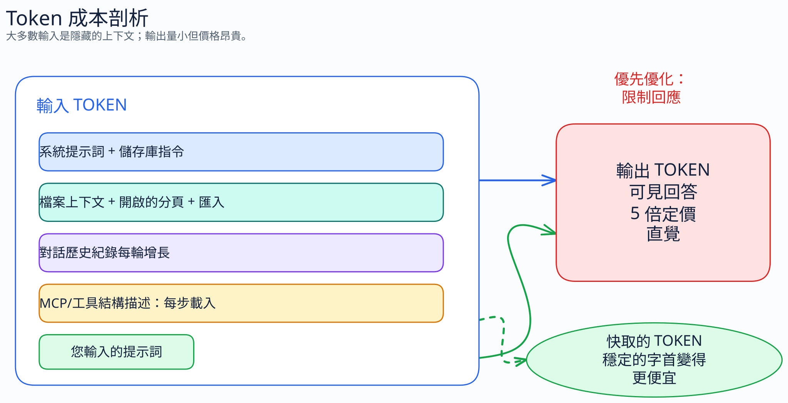

# 第 1 部分：為什麼 Token 很重要

[← 返回指南](index.md)

---

## 1.1 什麼是 Token？

大型語言模型讀取與寫入的單位是 token。一個 token 可以代表一個單字、單字的一部分，或是標點符號。位元組對編碼（Byte-Pair Encoding，BPE）會從反覆出現的位元組序列建立出這些單位。

### BPE 的運作方式

1. 從原始位元組開始（共 256 種可能的值）
2. 找出訓練資料中最常出現的位元組對
3. 將這些位元組對合併為新的 token
4. 重複上述步驟，直到詞彙表達到約 10 萬個 token

結果是：常見的英文單字會成為單一 token，而罕見或較長的單字則會被拆成多個片段。

### 範例

| 文字 | Token | 數量 |
|------|--------|-------|
| `hello` | `hello` | 1 |
| `unhappiness` | `un` + `happiness` | 2-3 |
| `authentication` | `authentication` | 2-3 |
| `I met a huge dog` | `I` `met` `a` `huge` `dog` | 5 |
| `Sure, I'd be happy to help you with that!` | （每個單字／標點符號） | ~10 |

最後一個範例花了大約 10 個 token 在開場白上，卻沒有回答問題。刪減這類贅詞，是減少 token 用量的簡單方法。

在 Claude 3 的分詞器中，最常見的 10,000 個英文單字裡，有 8,311 個會被分成單一 token。常見單字單獨來看成本很低，但不必要的單字累積起來仍然可觀。

## 1.2 為什麼你應該在意

你傳送或接收的每一個 token 都有成本。原因如下：

| 面向 | 影響 |
|-----------|--------|
| **成本** | API 定價以 token 計價，GitHub Copilot 的使用限制也以 token 為基礎。在 Anthropic 的範例中，**輸出的每個 token 費用是輸入的 5 倍**：每百萬 token（MTok）Haiku 為 $1/$5、Sonnet 為 $3/$15、Opus 為 $5/$25。Copilot UBB 也會將 token 分成不同的計費類別；在將供應商的費率套用到 Copilot 支出之前，請先參閱[模型選擇與定價](11-models-and-pricing.md) |
| **速率限制** | 每個請求的 token 越少 = 在觸及上限前每分鐘可發出的請求越多 |
| **內容脈絡視窗** | 輸入（你的提示詞 + 內容脈絡）與輸出（回應）共用有限的空間。浪費輸入 token → 輸出可用的空間就變少 |
| **速度** | 較少的輸入 token 可縮短首個 token 的回應時間 |
| **計費** | 自 2026 年 6 月 1 日起，GitHub Copilot 採用**使用量計費（usage-based billing，UBB）**。每次互動會依三種類別計量：輸入 token（提示詞 + 內容脈絡 + 歷程記錄）、輸出 token（回應），以及快取 token（重複使用的內容脈絡，以約輸入費率的 10% 計費）。成本 =（輸入 × 輸入費率）+（快取 × 快取費率）+（輸出 × 輸出費率）。Business 與 Enterprise 席次包含由整個組織共用的 AI 點數集區（CB 每席次 $30、CE 每席次 $70）。程式碼完成功能仍維持無限制 |

大部分的輸入 token 來自檔案內容脈絡、對話歷程記錄、系統提示詞，以及 MCP 工具結構描述。你輸入的提示詞通常只有 5–100 個 token，但在代理程式模式下，總輸入可高達 5,000–50,000 個以上。若要減少輸入，請把重點放在指示的大小、開啟的索引標籤，以及內容脈絡的範圍。若要減少輸出，請只要求你需要的回應。

## 1.3 GitHub Copilot 如何使用 Token

Copilot 的輸入包含：

- **系統提示詞：** Copilot 自身的指示（你無法控制）
- **`copilot-instructions.md`：** 你的專案層級指示 — 在**每一次**互動中都會載入
- **檔案內容脈絡：** 你以 `#file` 參照的檔案，加上 Copilot 自動納入的檔案（開啟的索引標籤、匯入項目、鄰近檔案）
- **對話歷程記錄：** 目前對話中所有先前的訊息
- **你的提示詞：** 你實際輸入的內容

Copilot 還會加入儲存庫結構、檔案內容與匯入關係圖。因此，一個 20 字的提示詞可能就會消耗 2000 個以上的輸入 token。

GitHub Coding Agent 會在多個步驟中讀取檔案、做出決策並撰寫程式碼。單一個從 issue 到 PR 的工作階段就可能消耗數萬個 token，因此在整個工作階段中減少重複的內容脈絡相當重要。

## 1.4 本指南適合哪些人

- **GitHub Copilot Chat 使用者** — 主要讀者。大多數技巧都適用於此
- **GitHub Copilot Inline/Edits 使用者** — 部分技巧適用（對提示詞的控制有限）
- **GitHub Coding Agent 使用者** — 高價值讀者。在長時間的工作階段中，節省的 token 會持續累積
- **任何關注效率的人** — 即使你沒有碰到限制，更快的回應與更乾淨的互動也值得追求

---

**下一章：**[提示詞壓縮 →](02-prompt-compression.md)
