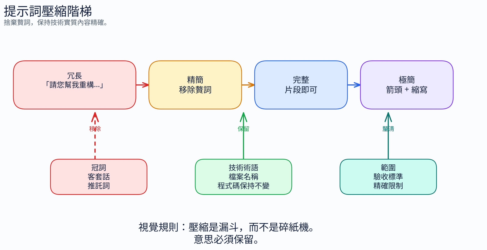

# 2.1 提示詞壓縮

[← 返回指南](index.md)

移除不會改變請求內容的字詞。保留需求、例外情況、技術術語，以及足以正確行動的內容脈絡。

縮短提示詞只會減少該提示詞的輸入大小，並不能證明整體任務成本會降低特定百分比。檔案內容脈絡、工具、歷程記錄、輸出與重試也都會計入成本。

## 2.1.1 從清楚、簡潔的文字開始

| 冗長的請求 | 簡潔的請求 |
|---|---|
| "Could you please review this pull request and let me know if there are any issues?" | "Review PR. Flag issues." |
| "Can you explain what this error message means and how I should fix it?" | "Explain this error and how to fix it." |

這些是撰寫範例，並非實際量測的模型執行結果。Token 數量取決於分詞器；品質則取決於改寫後是否保留了任務所需的內容。

不要刪除會改變語意的不確定性。「可能為 null」與「為 null」並不相同。請保留否定、條件、數字、單位與步驟順序。

## 2.1.2 選用的簡寫



| 風格 | 適用時機 | 注意事項 |
|---|---|---|
| 簡潔的文字 | 提示詞與文件的預設做法 | 不必要的鋪陳 |
| 片段句／Caveman 風格簡寫 | 共用的內容脈絡已讓語意明確 | 遺漏主詞、條件或步驟順序 |
| 縮寫與箭頭 | 有範圍限定的技術表達需要使用 | 語意模糊與不熟悉的簡寫 |

這些層級並沒有普遍適用的節省或品質保證。請從一般的簡潔語言開始，而不是追求最大程度的壓縮。至於獨立的 Caveman **回應風格技能**，請參閱[輸出證據與限制](05-output-control.md#caveman-optional-output-style)。

## 2.1.3 結構化格式優於散文

當請求包含多個獨立的需求時，請使用項目符號或鍵值對。

**散文：**

```text
I need you to create a REST API endpoint that accepts POST requests at /api/users.
It should validate that the request body contains a name field (string, required)
and an email field (string, required, must be valid email format). If validation
fails, return a 400 status with error details. On success, save to the database
and return 201 with the created user object.
```

**結構化：**

```text
POST /api/users
Validate:
- name: string, required
- email: string, required, valid format
400 on validation fail (include errors)
201 on success (return created user)
Save to DB
```

結構化的寫法讓驗證、儲存與回應的需求更容易檢視。請不要從這組手寫的對照範例推論出基準測試的百分比。

## 2.1.4 縮寫與簡寫

請使用熟悉的領域術語，例如 API、HTTP、DB 與 PR。在依賴專案專屬的簡寫之前，請先定義它。較短的拼寫不一定會使用較少的 token。

程式碼、命令、路徑、識別碼與引用的錯誤訊息都必須保持原樣。

## 2.1.5 以程式碼為中心的提示

參照既有的程式碼，有時會比重述其行為更清楚：

```text
Like getUserById but for emails. Return 404 if missing.
```

僅在代理程式能檢視所參照的函式時才使用這種方式。若有任何差異，請明確說明。

## 2.1.6 重質不重量 — 限定範圍，不要堆疊規則

當模型出錯時，在新增全域規則之前，請先檢查任務本身是否清楚。

| 症狀 | 較佳的處理方式 |
|---|---|
| 漏掉邊界情況 | 將該情況納入任務與其測試中 |
| 產生不需要的說明 | 指定所需的回應格式 |
| 探索不相關的檔案 | 指明目標與驗收條件 |
| 遺漏特定路徑的慣例 | 使用[限定範圍的指示](04-context-management.md#scoping-guidance) |

## 2.1.7 宣告式防護欄

當順序不重要時，請說明所需的結果。當順序重要時，才使用有順序的步驟。

| 偏重程序的請求 | 偏重結果的請求 |
|---|---|
| "First read the file, then identify all the public functions, then for each one check whether it has a JSDoc comment, and if it doesn't, add one." | "All exported functions: JSDoc required." |
| "Make sure that whenever you write a SQL query you always parameterize the values to prevent injection attacks and never use string concatenation." | "SQL: parameterized queries only. No concatenation." |

## 2.1.8 將可重複使用的規則放在適當的位置

將任務專屬的需求放在任務中。至於全域、特定路徑與隨需提供的指引，請使用[內容脈絡管理](04-context-management.md#scoping-guidance)。[入門範本](10-practical-setup.md#step-1-set-a-concise-response-default)位於實務設定中。

---

**下一章：**[語言比較 →](03-language-comparison.md)
