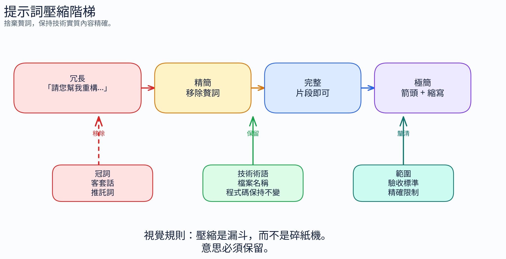

# 2.1 提示詞壓縮

[← 返回指南](index.md)

移除不會改變請求內容的字詞。保留需求、例外情況、技術術語，以及足以正確採取行動的上下文。

縮短提示詞只會減少該提示詞的輸入大小，並不代表整體任務成本能減少某個百分比。檔案上下文、工具、歷史記錄、輸出與重試也都會計入。

## 2.1.1 從清晰、簡潔的文字開始

| 冗長的請求 | 簡潔的請求 |
|---|---|
| "Could you please review this pull request and let me know if there are any issues?" | "Review PR. Flag issues." |
| "Can you explain what this error message means and how I should fix it?" | "Explain this error and how to fix it." |

這些是寫作範例，並非實測的模型執行結果。Token 數量取決於 tokenizer；品質則取決於改寫後是否保留了任務所需的內容。

不要刪除會改變語意的不確定性。「可能為 null」與「為 null」並不相同。請保留否定、條件、數字、單位與步驟順序。

## 2.1.2 選用的簡寫



| 風格 | 適用時機 | 注意事項 |
|---|---|---|
| 簡潔的文字 | 提示詞與文件的預設做法 | 不必要的鋪陳 |
| 片段句／Caveman 風格簡寫 | 共用的上下文讓意思清楚時 | 遺漏行為者、條件或步驟順序 |
| 縮寫與箭頭 | 有範圍限定的技術表達需要時 | 歧義與不熟悉的簡寫 |

這些層級都沒有一般性的節省或品質保證。請從一般的簡潔語言開始，而不是追求最大程度的壓縮。關於另外獨立的 Caveman **回應風格技能**，請參閱[輸出證據與限制](05-output-control.md#caveman-optional-output-style)。

## 2.1.3 將不同的需求結構化

當請求包含多項不同的需求時，使用項目符號或鍵值對。

**文字敘述：**

```text
I need you to create a REST API endpoint that accepts POST requests at /api/users.
It should validate that the request body contains a name field (string, required)
and an email field (string, required, must be valid email format). If validation
fails, return a 400 status with error details. On success, save to the database
and return 201 with the created user object.
```

**結構化：**

```text
POST /api/users
Validate:
- name: string, required
- email: string, required, valid format
400 on validation fail (include errors)
201 on success (return created user)
Save to DB
```

結構化讓驗證、儲存與回應需求更容易檢查。請不要從這組手寫的對照推論出基準測試的百分比。

## 2.1.4 縮寫與簡寫

使用熟悉的領域術語，例如 API、HTTP、DB 與 PR。在依賴專案專屬的簡寫之前，請先定義它。較短的拼寫不一定使用較少的 token。

程式碼、命令、路徑、識別碼與引用的錯誤訊息必須保持精確。

## 2.1.5 以程式碼為中心的提示

參照現有程式碼，可能比重述其行為更清楚：

```text
Like getUserById but for emails. Return 404 if missing.
```

僅在代理程式能檢查所參照的函式時才使用這種做法。任何差異都要明確說明。

## 2.1.6 在新增規則之前先確定任務範圍

當模型出錯時，請先確認任務是否清楚，再新增全域規則。

| 症狀 | 較好的因應方式 |
|---|---|
| 遺漏邊界情況 | 將該情況納入任務及其測試 |
| 產生不需要的說明 | 指定所需的回應格式 |
| 探索不相關的檔案 | 指明目標與驗收條件 |
| 遺漏特定路徑的慣例 | 使用[限定範圍的指示](04-context-management.md#scoping-guidance) |

## 2.1.7 宣告式防護欄

當順序無關緊要時，說明所需的結果即可；當順序重要時，則使用有順序的步驟。

| 偏重程序的請求 | 偏重結果的請求 |
|---|---|
| "First read the file, then identify all the public functions, then for each one check whether it has a JSDoc comment, and if it doesn't, add one." | "All exported functions: JSDoc required." |
| "Make sure that whenever you write a SQL query you always parameterize the values to prevent injection attacks and never use string concatenation." | "SQL: parameterized queries only. No concatenation." |

## 2.1.8 將可重複使用的規則放在適當的位置

任務專屬的需求放在任務中。至於全域、特定路徑與按需載入的指引，請使用[上下文管理](04-context-management.md#scoping-guidance)。[入門範本](10-practical-setup.md#step-1-set-a-concise-response-default)位於實務設定中。

---

**下一章：** [語言比較 →](03-language-comparison.md)
