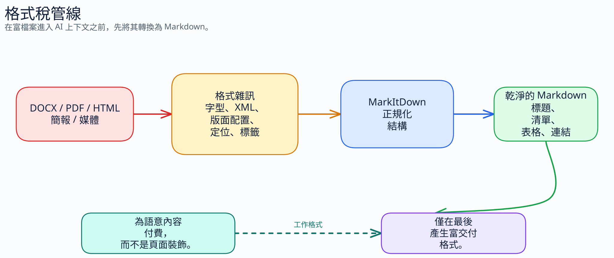
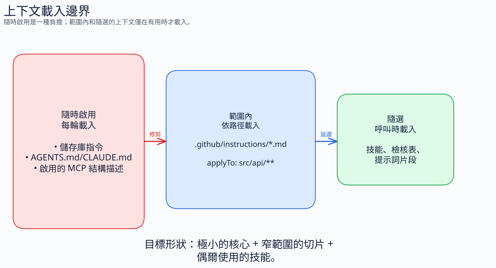
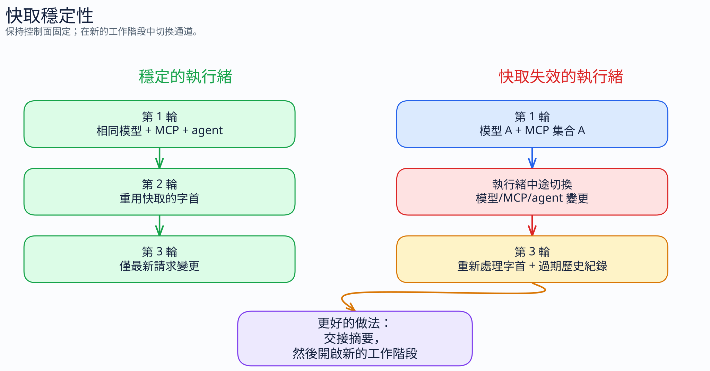

# 2.3 內容脈絡管理 — 控制傳送的內容

[← 返回指南](index.md)

---

## 2.3.1 系統指示壓縮

Copilot 在每次互動時都會載入 `.github/copilot-instructions.md`。縮短它可以減少重複的輸入。

> `.github/copilot-instructions.md` 是 Copilot 的儲存庫層級指示檔案。`AGENTS.md` 則是跨工具的慣例，Copilot 也會讀取。兩者可以並存：共用規則放在其中一個，Copilot 專屬規則放在另一個。請避免重複相同的指引，因為兩個檔案一旦載入，都會計入內容脈絡。關於應保留哪些內容，請參閱[第 2.6 部分](07-agents-md-problem.md)。

一個約 500 字、約 700 個 token 的指示檔案，會在你提出問題之前，就為每一次互動加上這些輸入。

在縮短個別句子之前，請先移除重複與不相關的規則。回應偏好請使用[入門範本](10-practical-setup.md#step-1-set-a-concise-response-default)，專案指引則請使用[研究篩選準則](07-agents-md-problem.md#265-what-to-actually-put-in-context-files)。

## 2.3.2 記憶體檔案壓縮

專案也會累積 `CLAUDE.md`、專案筆記、程式碼撰寫指引與 `.cursorrules`。當這些檔案進入內容脈絡時，就會增加輸入 token。在縮短個別檔案之前，請先移除重複的指引。

刪除過時的筆記與重複的規則。請保留命令、路徑、否定、條件與步驟順序。偶爾才會用到的檢查清單請放在提示詞之外。只有在該檔案原本就會被載入時，縮小它才有幫助。

## 2.3.3 策略性的檔案組織

Copilot 會自動納入工作區中的內容脈絡 — 開啟的檔案、匯入的模組、鄰近的檔案。你可以控制哪些內容會被納入。

**官方的排除機制是內容排除（Content Exclusion）**，由儲存庫／組織／企業的管理員透過 GitHub 設定或 REST API 進行設定。它僅適用於 **Copilot Business 與 Enterprise**，且**不**適用於 Copilot CLI、Copilot 雲端代理程式，或 IDE 中 Copilot Chat 的 Agent 模式。請將它視為隱私／原則控制（「不要讀取這個檔案」），而非每位開發人員用來節省 token 的調整選項。請參閱 [GitHub Docs — Excluding content from GitHub Copilot](https://docs.github.com/en/copilot/how-tos/configure-content-exclusion/exclude-content-from-copilot)。

若要減少自動納入的內容脈絡：

- **關閉你未在處理的檔案。** 開啟的索引標籤會成為自動納入內容脈絡的一部分。請關閉與任務無關的大型檔案。
- **讓檔案保持專注且小巧。** 如果開啟了一個 1,000 行的檔案，Copilot 可能會將其中大量內容作為內容脈絡傳送。請將大型檔案拆分為專注的模組。
- **對建構輸出、vendor 目錄與產生的檔案使用 `.gitignore`。** Git 忽略的內容通常不會被當作自動內容脈絡拉入，順帶也能讓你的儲存庫保持乾淨。
- **使用 `applyTo:` 限定範圍的指示檔案**（請參閱下方的 § 2.3.4），讓各領域的內容脈絡只在相關檔案開啟時才載入 — 這是縮減每次互動內容脈絡最可靠的方式。
- **對於 Business/Enterprise 客戶：** 請要求你的儲存庫／組織管理員，針對真正敏感的路徑（密碼、產生的套件組合、大型資料檔案）設定**內容排除（Content Exclusion）**。其主要目的是原則控制，但也能讓這些內容不進入 Chat／程式碼完成。

當下列來源開啟或被參照時，請檢查它們是否為大型內容脈絡的來源：

- 大型 README 檔案
- 產生的檔案（建構輸出、打包的 CSS、壓縮過的 JS）
- Vendor 目錄
- 資料檔案（CSV、JSON 測試資料）
- 封存的文件
- 富格式文件（`.docx`、`.pdf`、`.pptx`、`.xlsx`、HTML 匯出檔、掃描影像、音訊／影片逐字稿）

每個進入內容脈絡的檔案都會消耗 token。請審慎決定開啟哪些檔案，以及以 `#file` 參照哪些檔案。

### 先將非文字輸入正規化為 Markdown

在將 Word 檔案、PDF、PowerPoint 簡報、試算表、影像、音訊與匯出的 HTML 內容傳送給模型之前，請先將它們轉換為乾淨的 Markdown。



Marc Bara 在 [Your .docx Is Wasting 33% of Your AI Budget](https://medium.com/@marc.bara.iniesta/your-docx-is-wasting-33-of-your-ai-budget-86a3d229d042) 一文中將此稱為**格式稅（format tax）**。富格式帶有字型資料、XML、頁面位置、內嵌物件與標記，而這些是模型很少需要的。在該文章的範例中，一份 10 頁的 PDF 報告約使用 12,400 個 token；乾淨的 Markdown 則約為 8,350 個，在資訊相同的情況下減少了 33%。HTML 匯出檔則可能在內容周圍加入更多版面標記。

原則是：以 Markdown 作為與 AI 互動的**工作格式**，並將 Word/PDF/PowerPoint 視為交付格式。請在 Markdown 中進行草擬、審查、摘要、分塊與擷取。只有在客戶、監管機構或內部流程需要該成品時，才在最後產生 `.docx` 或 `.pdf`。

[Microsoft MarkItDown](https://github.com/microsoft/markitdown) 是用於 LLM 與文字分析管線的 Python 轉換器。它會保留標題、清單、表格、連結與擷取的 Metadata，但不會重現視覺版面。支援的轉換器包括 PDF、Word、PowerPoint、Excel、支援 EXIF/OCR 的影像、支援轉錄的音訊、HTML、CSV/JSON/XML、ZIP 內容、YouTube URL、EPUB 等。

快速上手：

```bash
pip install 'markitdown[all]'
markitdown report.docx -o report.md
markitdown deck.pptx -o deck.md
markitdown source.pdf > source.md
```

當你能掌控工作流程並希望減少相依項目時，請使用較精簡的額外套件：

```bash
pip install 'markitdown[pdf,docx,pptx,xlsx]'
```

安全性注意事項：MarkItDown 會以目前處理序的權限讀取檔案、串流與 URL。對於不受信任的輸入，請先驗證路徑與 URL，並優先使用符合工作流程需求且範圍最窄的轉換 API。

<span id="scoping-guidance"></span>

## 2.3.4 有意識地限定內容脈絡範圍 — 條件式優於常駐

請讓特定路徑的規則不要進入常駐的內容脈絡。React 元件的任務不需要資料庫移轉的指引。請以條件式載入這些規則。



### 在自訂指示中使用 `applyTo:` 路徑

位於 `.github/instructions/*.instructions.md` 的自訂指示檔案，接受 `applyTo` 前置資料欄位，用來將該檔案限定於相符的路徑。Copilot 只有在對話涉及符合該 glob 的檔案時才會載入它。

```markdown
---
applyTo: "src/api/**/*.ts"
---
API 慣例：
- 路由放在 src/api/routes/。Handler 保持精簡，邏輯放在 services/。
- 使用 zod 驗證。以 Result<T,E> 回報錯誤，絕不 throw。
- 所有端點都回傳 { data, error } 封裝。
```

若沒有 `applyTo`，這約 30 個 token 會在整個儲存庫的每次 Copilot 呼叫中載入。有了它，只有在你實際編輯 API 程式碼時才會付出這項成本。

請將大型的 `copilot-instructions.md` 拆分為一個小型的常駐核心，以及限定範圍的檔案，例如 `api.instructions.md`、`ui.instructions.md`、`tests.instructions.md` 與 `migrations.instructions.md`。為每個檔案指定各自的 `applyTo` glob，讓只有相關的指引會被載入。

### 善用隨需指引與 MCP 工具探索

各工作流程專屬的指引應遵循與 MCP 工具相同的規則：不要放在常駐的提示詞中，只在任務需要時才引入。如果你只是偶爾使用，PR 審查檢查清單、發行範本或偵錯手冊就不屬於 `copilot-instructions.md`。

請將小型提示詞檔案、斜線命令片段或儲存的檢查清單，作為*工作流程專屬*指引的存放處。在你叫用它們之前，它們不會出現在日常的內容脈絡中。

### 原則

- **常駐：** 真正適用於每次互動的少數規則，例如整個專案的慣例。
- **條件式（`applyTo`）：** 任何特定路徑的內容（依語言、模組、層級而定）。
- **隨需筆記／MCP：** 任何偶爾才會叫用的工作流程專屬內容。

縮減幅度取決於原本會載入哪些檔案。請保留每項任務所需的規則；並在限定範圍前後，比較實際載入的內容脈絡。

> **請量測已載入的內容脈絡，而不是磁碟上的檔案大小。** 技能在其完整指示載入之前，就可能貢獻探索用的 Metadata。關於已載入／延後載入的區別，請參閱 [MCP 與工具成本 §2.7](08-mcp-tool-costs.md)。

## 2.3.5 快取 — 在提示詞之間儲存並重複使用內容脈絡

Copilot 可以快取穩定的內容脈絡，包括系統提示詞、指示檔案與最近載入的檔案，而不是在每一輪都以完整的輸入費率處理它們。

在長時間的工作階段中，快取輸入可以帶來相當大的差異。折扣最高可達約 90%，取決於供應商、模型、Copilot 介面與計費規則。

三種保留可重複使用內容脈絡的方式：



**1. 穩定的指示放在上方，易變的工作放在下方。** 只有當對話的前綴保持穩定時，快取的內容脈絡才會發揮作用。請不要在每次提示詞之間重新排列你的 `copilot-instructions.md`，或更換開啟的檔案 — 讓穩定的那一層保持穩定，只讓最新的訊息有所變動。

**2. 透過斜線命令與儲存的片段重複使用具名的內容脈絡。** 當你經常詢問同一個領域時，請定義一次，然後加以參照。例如：保留一份簡短的客戶結構描述筆記或斜線命令片段，在工作階段中載入一次，之後的提示詞就以該共用摘要為依據，而不是每次都重新貼上結構描述。

**3. 保持請求前綴穩定。** 前綴包含系統提示詞、工具／MCP 定義與指示檔案（即 `System/Tools` 基準；請參閱 [MCP 與工具成本 §2.7](08-mcp-tool-costs.md)）。下列變更可能使快取的內容脈絡失效：

| 工作階段中途的變更 | 對快取與內容脈絡的影響 |
|--------------------|---------------------------|
| **切換模型或推理強度** | 快取通常是以模型為單位，變更模型設定可能會捨棄快取的前綴。已累積的歷程記錄可能會在新的設定下重新處理。請參閱[模型與推理強度的選擇](11-models-and-pricing.md#good-default-heuristics)。 |
| **切換自訂代理程式** | 會更換系統提示詞、工具集與指示 — 前綴隨之改變，因此快取失效，而先前累積的內容脈絡在新的代理程式下會變成雜訊。 |
| **切換 MCP 伺服器、工具或已載入的技能** | 會改變前綴中的執行框架及其工具／指示定義 — 快取失效，而且你還會在之後每一輪增加或移除常駐載入的 token。 |
| **大幅變動內容脈絡** | 附加／移除大型檔案或貼上大量內容，會重新洗牌內容脈絡，削弱前綴的穩定性。請預先選好你的檔案與內容脈絡。 |

快取的前綴可以同時減少處理時間與輸入成本。

```text
快取穩定的長對話串

第 1 輪     第 2 輪     第 3 輪     第 4 輪
|          |          |          |
v          v          v          v
[相同模型 + 相同推理強度 + 相同技能/MCP 集合 + 相同代理程式/設定檔]
[穩定的提示詞前綴從快取重複使用          ]  -> 有效輸入成本較低
[只有最新的使用者請求會改變              ]

快取失效的長對話串

第 1 輪     第 2 輪        第 3 輪
|          |             |
v          v             v
[模型 A + MCP 集合 A + 代理程式 A]
[快取前綴建立中               ]
                  |
                  v
          切換模型 / 推理強度 / 技能 / MCP / 代理程式
                  |
                  v
[大型前綴失效或重新計價] -> 失去快取折扣；請改為重新開始
```

### 必須切換時的安全交接模式

請在進行長時間工作之前，先選好模型、推理強度、代理程式與工具。當需要不同的設定時，請帶著相關的內容脈絡重新開始，而不是沿用整個對話串。計費行為會因介面與方案而異；這並非保證的重新計價算式。

1. 以 5-10 個項目符號摘要目前的對話串（決策、限制、未完成的任務）。
2. 使用新的模型／代理程式／MCP 設定開啟新的聊天。
3. 只貼上摘要與所需的檔案，而不是整份舊的逐字紀錄。

這能讓舊的、不相關的內容脈絡不進入新的工作階段。

## 2.3.6 開啟全新的對話

對話歷程記錄會持續累積。在 20 則以上的訊息之後，你可能會在每則新訊息中都送出 5 萬個以上 token 的歷程記錄。

**何時該重新開始：**

- 主題改變 — 新的問題、新的檔案、新的關注點
- 取得你需要的答案之後
- 回應開始變慢時（內容脈絡視窗逐漸填滿）
- 當你發現品質下降時（模型被舊的內容脈絡搞混）

**如何保持連貫性：** 在新的提示詞中摘要重要決策。「延續身分驗證重構 — 我們選擇了 JWT 而非 session。現在請實作 refresh token。」

## 2.3.7 持久性圖譜 — 取代每個工作階段的檔案讀取

如果重複的結構性檔案讀取佔據了大部分內容脈絡，請考慮使用持久性的程式碼庫地圖。[Graphify 的設定、輸出與限制](08-mcp-tool-costs.md#2711-persistent-codebase-maps-graphify)與其他工具放在一起說明。

---

**下一章：**[輸出控制 →](05-output-control.md)
