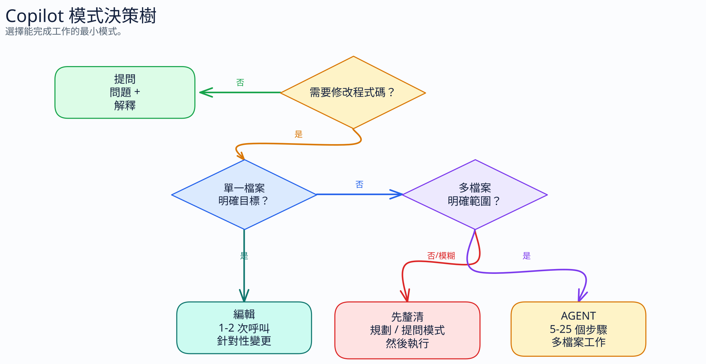

# 2.5 各工作流程專屬的最佳化

[← 返回指南](index.md)

---

## 2.5.1 提交訊息

使用 Conventional Commits，主旨不超過 50 個字元。當變更的原因不明顯時，請加上內文。

**冗長的提交（~25 個 token）：**

```text
feat: 新增一項功能，讓使用者可以透過設定頁面重設密碼，
同時也會寄送確認電子郵件
```

**精簡的提交（~10 個 token）：**

```text
feat: 透過設定頁面新增密碼重設功能

重設時會寄送確認電子郵件。
```

Coding Agent 會讀取 git 歷程記錄作為內容脈絡，因此簡潔的提交可以減少後續工作階段的輸入。

## 2.5.2 PR 審查

請使用單行格式，而不是長達一整段的審查留言：

**冗長的審查留言（~40 個 token）：**

```text
我注意到在第 42 行，user 變數在程式碼的這個位置可能為 null，
當你嘗試存取使用者的 email 屬性時，會導致 NullPointerException。
你應該在存取這個屬性之前加入 null 檢查，
以妥善處理這個邊界情況。
```

**精簡的審查（~12 個 token）：**

```text
L42: 🔴 bug：此處 user 可能為 null。存取 .email 之前請加上 null 防護。
```

**節省幅度：~70%。** 較短的留言仍然指出了錯誤、位置與修正方式。

嚴重性前綴以 1-2 個 token 編碼優先順序：

- 🔴 錯誤／安全性問題 — 必須修正
- 🟡 建議 — 應該修正
- 🔵 細節挑剔 — 選擇性的改進
- ❓ 問題 — 需要釐清

## 2.5.3 Ask 模式與 Agent 模式

**Agent 模式**每個可見的動作可能觸發 3-10 次內部模型呼叫。它會讀取檔案、規劃、執行、驗證。每個步驟都會消耗 token。

**Ask 模式**是單次呼叫。一個問題，一個答案。



| 任務 | 適合的模式 | 原因 |
|------|-----------|-----|
| 「這個函式做什麼？」 | Ask | 單次回答。不需要使用工具 |
| 「TypeScript 泛型的語法是什麼？」 | Ask | 知識性問題 |
| 「更新這些已知檔案中的驗證」 | Edit（若有提供） | 範圍明確、內容脈絡清楚的變更 |
| 「重構這個模組以使用相依性注入」 | Agent | 多檔案變更，需要讀取／撰寫程式碼 |
| 「建立一個附帶測試與文件的 REST API」 | Agent | 多步驟的建立任務 |
| 「為什麼這個測試會失敗？」 | Ask（通常） | 通常只需要錯誤訊息，加上你提供的內容脈絡 |

Ask 可以避免不必要的工具迴圈。差異取決於 Agent 實際會載入與執行的內容；每個問題並沒有固定的節省率。

### 進階 Copilot CLI 策略：CodeAct

對於**大量使用工具的 Copilot CLI 工作階段**，選用的外部 [`copilot-codeact-plugin`](https://github.com/jsturtevant/copilot-codeact-plugin) 可以合併工具操作。代理程式不再於許多輪次中交替進行模型與工具呼叫，而是撰寫一段 Python 程式，並在一次沙箱化的執行中跑完整個序列。

為什麼這樣可以節省 token：

- 輪次變少，代表系統提示詞、先前訊息與內建工具定義的重播次數也變少。
- 如果載入了 MCP 伺服器，它們的工具目錄被重播的次數也會減少，因此節省效果可以疊加。
- 一份整合後的結果，通常比逐一敘述每個中間的 `grep` / `view` / `bash` 步驟還要簡短。

何時使用：

- 大量使用 CLI 的探索或稽核任務，否則會在許多小型工具呼叫之間來回
- 已載入 MCP 的工作階段，其結構描述重播的成本本來就很高
- 可重複的分析任務，例如 TODO 掃描、函式索引、涵蓋率檢查或交叉參照蒐集

何時不使用：

- 簡單的單次 Ask 問題
- 該外掛程式不適用的一般 IDE 聊天／編輯工作流程
- 不想在工作流程中引入外部外掛程式的團隊

外掛程式的 README 回報了它自己的基準測試提示詞上的節省幅度，包括已載入 MCP 的情況。本指南並未獨立對 CodeAct 進行基準測試；這些結果並不能證明每項任務都能節省。

### 互補方案：使用 RTK 或 snip 壓縮工具輸出

CodeAct 減少的是工具呼叫的*次數*。[**RTK (Rust Token Killer)**](https://github.com/rtk-ai/rtk) 與 [`snip`](https://github.com/edouard-claude/snip) 減少的是每個 shell 工具結果的*大小*。它們處理的是同一個問題的不同面向，可以搭配使用。

這些工具會在 `git`、測試執行器、`grep`、`ls` 與其他命令的結果抵達代理程式之前，先對它們進行篩選。縮減幅度取決於命令與輸出。與 CodeAct 不同，這並不僅限於 Copilot CLI；只要 shell hook 可靠，就能發揮作用。請將 Windows 與預覽版的 hook 路徑視為試行項目。設定方式請參閱 [MCP 與工具成本 §2.7.7](08-mcp-tool-costs.md#277-compress-tool-output-at-the-source-rtk) 與 [§2.7.8](08-mcp-tool-costs.md#278-rtk-alternative-snip)。

## 2.5.4 預設使用自動模型選擇

模型與推理強度的選擇請參閱[模型選擇與定價](11-models-and-pricing.md#good-default-heuristics)。快取穩定性與交接請遵循[內容脈絡管理](04-context-management.md#235-caching-store-and-reuse-context-within-prompts)。

## 2.5.5 針對目標模型重新調校提示詞

重新調校提示詞不一定會縮短每個請求。它的目的是改善第一次的結果，並避免後續輪次、重複釐清與重工。

模型供應商會發布隨模型版本而變動的提示詞撰寫指南。請將模型升級視為相依套件升級：閱讀移轉／提示詞指南，然後針對該模型目前的行為調整你的提示詞與指示檔案。

**工作流程：**

```text
開啟目標模型的官方提示詞撰寫指南。
將 URL 貼到 Copilot 聊天中。
詢問：「依照這份指南調整這些目標檔案。保持行為不變。減少重工。」
目標檔案：.github/copilot-instructions.md、.github/instructions/*.instructions.md、agents/*.md、應用程式提示詞檔案。
審查差異。只保留可量測且與模型相關的變更。
```

官方起點：

| 供應商 | 模型系列 | 提示詞撰寫指南 |
|---|---|---|
| Anthropic | Claude Sonnet / Opus / Haiku | [Prompt engineering overview](https://platform.claude.com/docs/en/build-with-claude/prompt-engineering/overview)與 [Claude latest-model best practices](https://platform.claude.com/docs/en/docs/build-with-claude/prompt-engineering/claude-4-best-practices) |
| OpenAI | GPT-5.5 / GPT-5 | [GPT-5.5 prompting guide](https://developers.openai.com/api/docs/guides/prompt-guidance)與 [GPT-5 prompting guide](https://cookbook.openai.com/examples/gpt-5/gpt-5_prompting_guide) |
| Google | Gemini | [Gemini prompt design strategies](https://ai.google.dev/gemini-api/docs/prompting-strategies) |

### 範例：一個基礎指示，三種調校方式

基礎指示：

```markdown
你是一位程式設計助理。協助進行實作。保持簡潔。有需要時請提問。遵循儲存庫的風格。執行測試。
```

針對特定模型的改寫：

| 目標模型 | 調校後的指示 | 為何適合 |
|---|---|---|
| **Claude Sonnet** | `角色：資深儲存庫工程師。\n有幫助時使用類 XML 的區段：<task>、<constraints>、<done>。\n編輯之前：只檢視相關檔案。保留既有風格。\n對於模稜兩可的請求：只有在選擇會改變實作時才提問。\n完成 = 已套用修補 + 既有的目標測試通過，或指出阻礙因素。` | Claude 的指南強調明確的成功條件、範例／結構、明確的工具／使用邊界，以及經過校準的投入程度。XML 風格的分隔符號通常有助於區分任務、內容脈絡與限制。 |
| **GPT-5.5** | `成果：以最少的變動完成正確的儲存庫變更。\n成功：目標行為可運作、差異範圍受控、回報測試結果或確切的阻礙因素。\n選擇有效率的路徑；不要過度規範流程。\n在開始大量使用工具的工作時，先提供一則簡短的進度更新。\n只有在缺少會影響成果或安全性的資訊時才提問。` | GPT-5.5 的指南偏好以成果為導向的提示詞、簡潔的個性／協作規則、有效率的解決路徑、多步驟工作時可見的開場說明，並避免過時的過度規範。 |
| **Gemini** | `任務：實作所要求的儲存庫變更。\n內容脈絡：使用被參照的檔案、鄰近的測試與儲存庫慣例。\n限制：輸出簡潔、差異範圍受控、不做不相關的重寫。\n最終格式：變更的檔案 + 行為影響 + 測試結果／阻礙因素。\n如果輸入不完整，請說明所需的一項細節。` | Gemini 的指南強調清楚的任務／輸入／限制／回應格式結構。明確的格式與內容脈絡邊界可減少詮釋上的偏移。 |

### 給 Copilot 的使用者提示詞範例

```text
目標模型：GPT-5.5。
指南：https://developers.openai.com/api/docs/guides/prompt-guidance
檔案：.github/copilot-instructions.md、agents/token-saver.agent.md
依照指南調整提示詞。保留行為。減少重複釐清。保持簡潔。
只顯示差異。
```

在下列情況使用：

- 你升級或變更了預設模型。
- 某個提示詞在一個模型上運作良好，但在另一個模型上變得冗長、怠惰、過度積極或過於字面。
- 在模型變更之後，代理程式不斷做出同樣錯誤的假設。
- 你維護應用程式提示詞、代理程式設定檔或可重複使用的指示檔案。

當提示詞行為已經過量測且穩定時，請避免這麼做。在沒有失敗訊號的情況下變更指示，可能只會增加雜訊。

## 2.5.6 何時不該壓縮

壓縮有其限度。某些情況需要完整的清晰度：

- **安全性警告** — 「這將會刪除所有使用者資料」不能被縮寫成「del usr data」
- **不可逆的操作** — 確認提示必須明確無誤
- **新人上手的情境** — 新進團隊成員需要知道「為什麼」，而不只是「是什麼」
- **複雜的多步驟指示** — 當片段句的順序可能導致誤讀時
- **法規／合規文字** — 法律要求需要精確

請告知精簡範本或代理程式設定檔，對安全性警告與不可逆動作的確認使用完整且明確的措辭。

## 2.5.7 使用 `/chronicle` 形成回饋迴圈

反覆發生的誤解，浪費的 token 可能比一個冗長的提示詞還多。Copilot CLI 的 [`/chronicle`](https://docs.github.com/en/copilot/concepts/agents/copilot-cli/chronicle) 命令會分析本機的工作階段歷程記錄，找出混淆、重複修正，以及其他值得改善的模式。

> **範圍：** `/chronicle` 是 **Copilot CLI** 的功能，由 `~/.copilot/session-state/` 中的本機工作階段歷程記錄支援。它在 Copilot CLI 的互動式工作階段中執行 — 並可透過互動式 Copilot CLI 工作階段在 **JetBrains IDE** 內執行。它在 **VS Code** 中**無法使用**；VS Code 的使用量分析請參閱下方的 [AI Engineering Coach](#258-vs-code-usage-analytics-ai-engineering-coach)。
>
> **可用性：** `/chronicle` 目前為實驗性功能。請在互動式 Copilot CLI 工作階段中使用 `/experimental on` 啟用，或在命令列傳入 `--experimental`。

子命令包括 `standup`、`tips`、`cost tips`、`search`、`improve` 與 `reindex`。用於成本與工作流程審查：

| 命令 | 功能 | 節省 token 的回報 |
|---------|--------------|---------------------|
| **`/chronicle cost tips`** | 檢閱近期工作階段中的提示詞長度、工具呼叫頻率與接續步驟 | 直接的成本建議 |
| **`/chronicle improve`** | 找出重複的修正，並**產生自訂指示片段** | 可能避免反覆發生的誤解 |
| **`/chronicle tips`** | 根據你的使用情形，建議功能與工作流程的調整 | 可能找出更好的模式、模型或內容脈絡選擇 |
| **`/chronicle standup`** | 從工作階段資料中摘要分支、PR 與狀態 | 節省的是手動摘要的工作，而非直接節省 token |

### `cost tips` 工作流程

請每週執行一次，檢視 token 的流向：

```text
/chronicle cost tips
```

請利用它針對特定工作階段所提供的建議，決定要改變哪些習慣。

### `improve` 工作流程

請每週執行，或在你發現反覆出現混淆時執行：

```text
/chronicle improve
```

Copilot CLI 會讀取你近期的 CLI 工作階段，找出反覆出現的混淆（例如，它一直假設錯誤的測試框架，或一直詢問哪個目錄包含 API 程式碼），並建議要加入自訂指示的內容。請審查這些建議 — 接受那些符合專案實際注意事項的，略過那些只是 LLM 產生的樣板內容的（關於修剪為何重要，請參閱[第 7 部分：AGENTS.md 問題](07-agents-md-problem.md)）。

每次修正都會把你的後續訊息與累積的歷程記錄加入為輸入，再加上新的回應作為輸出。多出三輪就可能花費 1 萬至 3 萬個 token。只有在能解決反覆出現的失誤時，才加入專案專屬的指示。

### `tips` 工作流程

請每一到兩週執行一次：

```text
/chronicle tips
```

請保留適合你工作流程的建議，例如使用 Ask 模式進行說明、以 `applyTo` 限定指示的範圍，或停用未使用的 MCP 伺服器。

### 這在工作流程中的定位

- **每週：** `/chronicle cost tips` — 了解 token 的流向，以及 `/chronicle tips` — 找出遺漏的習慣。
- **當某件事感覺重複時：** `/chronicle improve` — 將摩擦轉化為一次性的修正。
- **每日站會（選用）：** `/chronicle standup last 24 hours` — 用於人員的例行儀式，而非為了 token。

所有工作階段資料都儲存在本機的 `~/.copilot/session-state/`，且只在你的電腦上。這是 **Copilot CLI 工作階段資料**，並非通用的 Copilot Chat 歷程記錄儲存區。當你執行 `/chronicle` 命令時，仍會套用標準的模型互動（資料會傳送給模型以產生摘要），但不會上傳任何資料以供儲存。

## 2.5.8 VS Code 使用量分析：AI Engineering Coach

[`/chronicle`](#257-close-the-loop-with-chronicle) 涵蓋 Copilot CLI 的工作階段。至於 VS Code 的使用情形，[**AI Engineering Coach**](https://github.com/microsoft/AI-Engineering-Coach) 是對應的工具 — 一個本機的 VS Code 擴充功能，會讀取你的 VS Code AI 工作階段記錄，並呈現同一類的洞察：反模式、token 模式、內容脈絡健全度與技能探索。

> **隱私：** 所有分析都在本機執行。沒有任何資料會離開你的電腦。此擴充功能是唯讀的 — 絕不會修改你的工作階段檔案。選用的 AI 功能（規則編譯器、內容脈絡審查）只有在你明確叫用時，才會使用 VS Code 內建的 Copilot 模型 API。

與 token 效率相關的主要功能：

| 功能 | 呈現的內容 |
|---------|-----------------|
| **反模式** | 涵蓋提示詞品質、工作階段衛生、程式碼審查、工具精熟度與內容脈絡管理的 45 條可編輯規則 — 附有嚴重性評等與具體的修正動作 |
| **內容脈絡健全度** | 代理程式就緒度檢查清單、工作區內容脈絡地圖，以及指示檔案稽核 |
| **技能搜尋器** | 偵測你歷程記錄中重複的提示詞模式，並與開放原始碼目錄中可重複使用的技能配對 |
| **輸出／燃燒圖** | 依語言與模型分類的 AI 產生程式碼量；附有預測的 token 預算進度 |

**快速上手：**

```bash
git clone https://github.com/microsoft/ai-engineering-coach.git
cd ai-engineering-coach
npm install && npm run package
code --install-extension ai-engineer-coach-*.vsix
```

然後按 `Cmd+Shift+P` → **AI Engineer Coach: Open Dashboard**。

請使用 `/chronicle` 處理 CLI 歷程記錄與指示建議。請使用 AI Engineering Coach 處理 VS Code 歷程記錄、內容脈絡膨脹、未使用的 MCP 與指示缺口。

## 2.5.9 先規劃，再執行（並為各階段選擇路由）

對於複雜的工作，請在實作之前先就驗收條件達成共識。完整的[規劃／執行／驗證工作流程](13-outcome-per-token.md#plan-first-then-execute-cheaply)說明了何時應分開工作階段，並使用較便宜的執行模型。

## 2.5.10 在 Copilot 執行框架之上疊加工具

Copilot CLI 與 VS Code Copilot 已經最佳化了代理程式迴圈的某些部分。在加入外部工具之前，請將其視為基準：


- **提示詞／快取層：** 讓 `{model, active MCP set, active agent/profile}` 保持穩定，使快取的前綴能持續被重複使用。
- **工具結構描述層：** 優先使用內建工具與限定範圍的 MCP；Copilot 可以延後或路由某些工具定義，但額外的伺服器與擴充功能仍會增加介面面積。
- **傳輸／工作階段層：** WebSocket 重複使用與自動壓縮有助於長時間的代理程式執行，但壓縮是對代理程式已看過的內容進行摘要。
- **終端機輸出層：** 內建的截斷是安全網，而不是語意篩選器。

請只針對真正有改善的層級，加入第三方工具：

| 層級 | 工具 | 減少的內容 |
|-------|---------|-----------------|
| 工作流程輪次 | CodeAct | 在 Copilot CLI 中，許多小型工具呼叫造成的重複重播 |
| 命令輸出 | RTK 或 snip | 冗長的 `git`、測試、grep、建構與基礎結構命令輸出 |
| 命令選擇 | minimal-context-tools | 透過引導使用 `rg`、`fd`、`jq`、`ast-grep`，減少大範圍的檔案讀取與反覆搜尋 |
| 程式碼庫環境熟悉 | Graphify | 跨工作階段重複的結構性檔案讀取 |
| 可見性／稽核 | [Tokentop](https://github.com/tokentopapp/tokentop)、Tokalator、token-optimizer | Tokentop 提供即時的本機工作階段、模型、token、成本與燃燒速率可見性；監控本身並不會壓縮 |

**原則：** 每一層只用一種工具。將 CodeAct 與 RTK 或 snip 搭配使用可能合理，因為一個減少輪次數，另一個減少輸出大小。但在同一個命令路徑上同時執行 RTK 與 snip 通常並不合理 — 這可能會造成輸出被重複截斷，並使失敗更難檢查。

請使用[實務設定](10-practical-setup.md#step-3-choose-mode-model-and-context)來套用這些選擇。工具的安裝說明位於[MCP 與工具成本](08-mcp-tool-costs.md)，而不在這份工作流程摘要中。

---

**下一章：**[AGENTS.md 問題 →](07-agents-md-problem.md)
