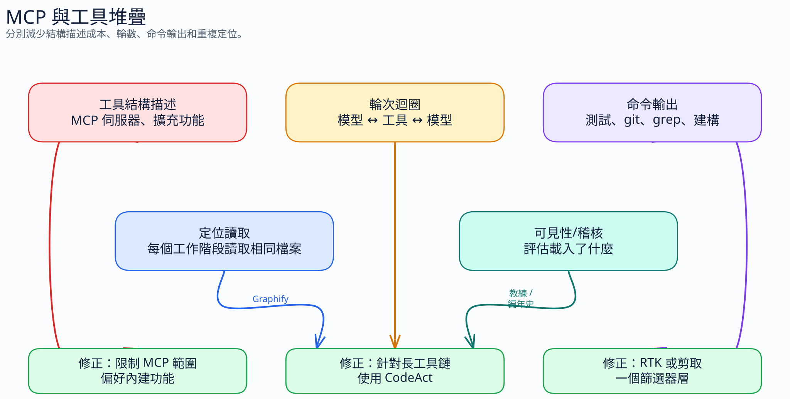
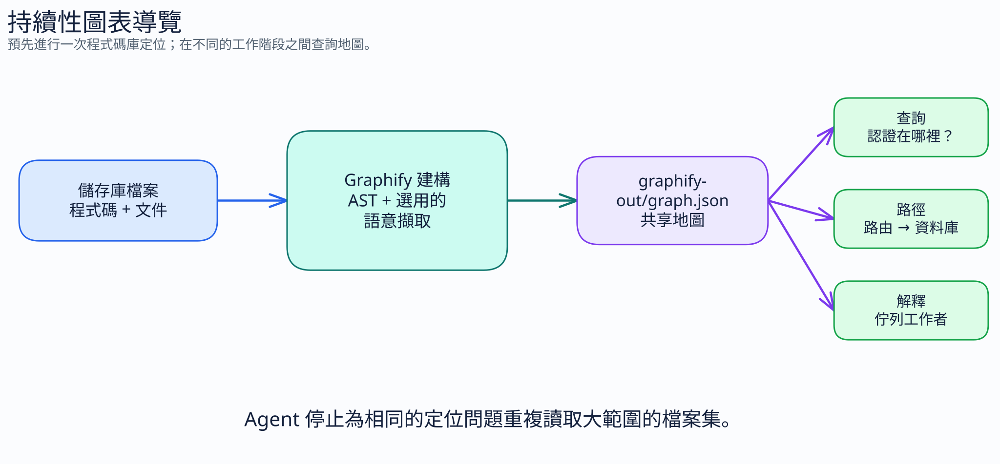

# 2.7 工具與 MCP 伺服器成本 — 隱藏的 Token 稅

[← 返回指南](index.md)

---

## 最佳化之前：先量測實際載入了什麼

在變更 MCP 伺服器或指示檔案之前，請先量測內容脈絡視窗中實際載入了什麼。



**Copilot CLI：** 在工作階段中途執行 `/context`，即可取得實際的細項分析：

```text
Context Usage  claude-opus-4.6 · 104k/200k tokens (52%)
System/Tools:  62.5k (31%)   ← 常駐載入：MCP + 指示 + 系統提示詞
Messages:      41.8k (21%)   ← 對話歷程記錄
Free Space:    55.3k (28%)
Buffer:        40.4k (20%)
```

**VS Code Copilot：** 檢查該任務所載入的工具與擴充功能。單看已安裝的伺服器數量，並不能確定 token 成本：主機可以延後載入定義。如果某個擴充功能注入了你在撰寫程式碼時不需要的工具，請在該工作區停用它，或使用精簡的 VS Code 設定檔。

**區分已安裝、已載入與隨需載入的內容：**

| 元件 | 載入時機 | 是否在內容脈絡視窗中？ |
|-----------|:-----:|:------------------:|
| MCP 工具定義 | 完整目錄或延後探索，取決於主機 | 已載入的定義與探索用 Metadata |
| 適用的代理程式／儲存庫指示 | 選取或符合時 | 已載入的指示 |
| 系統提示詞 | 每次模型請求 | 是 |
| 技能 | 先載入探索用 Metadata；叫用時才載入完整指示 | Metadata 以及任何已叫用的指引 |
| 對話歷程記錄 | 持續累積，受壓縮影響 | 請求中保留的歷程記錄 |

縮短一個本文從未被載入的技能，並不會節省該本文的 token。請檢查已載入的定義、探索用 Metadata 與指示，而不是磁碟上的檔案大小。偶爾才需要的指引請使用專注的技能，任務需要的即時功能則使用 MCP 伺服器；兩者都沒有固定的成本優勢。

> 請在長時間的工作階段之前選好工具與代理程式。變更 `System/Tools` 可能使快取的請求前綴失效。如果任務需要不同的設定，請以簡短的交接重新開啟工作階段。請參閱[快取 §2.3.5](04-context-management.md#235-caching-store-and-reuse-context-within-prompts)。

> Dina Berry（Microsoft/GitHub 內容貢獻者）量測了一個實際的 Copilot CLI 生產環境設定，發現單一個 Azure 外掛程式每則訊息就載入約 27K 個 token — 在她執行 `/context` 之前完全看不出來。[完整文章 →](https://dfberry.github.io/2026-05-06-tuning-up-copilot-context)

---

## 2.7.1 每個工具都會消耗 Token

已載入的 MCP 工具定義包含其函式名稱、描述與參數結構描述。在代理程式的各個步驟中重複這些定義，會增加輸入 token。

每個定義的大約大小：

| 元件 | ~Token |
|-----------|:-------:|
| 工具名稱 + 描述 | 20-50 |
| 參數結構描述（簡單） | 30-80 |
| 參數結構描述（複雜） | 100-300 |
| **每個工具總計** | **100-500** |

## 2.7.2 倍增問題

對於每個步驟都載入完整目錄的設定：

```text
已載入的工具 = 伺服器數 × 每個伺服器的工具數 × 每個工具的 token 數

範例（重度設定）：
  10 個 MCP 伺服器 × 每個 5 個工具 × 平均 200 個 token = 10,000 個 token

Agent 模式每項任務執行 5-25 個步驟。
工具定義在「每一個」步驟都會重新載入。

10,000 個 token × 15 個步驟 = 光是工具定義就有 150,000 個 token。
```

在這個範例中，結構描述定義在整個任務中佔了 150K 個 token，這還不包含提示詞、檔案讀取與回應。

## 2.7.3 工具呼叫成本

除了定義之外，每次工具*呼叫*也會消耗 token：

| 階段 | 成本 |
|-------|------|
| 函式名稱 + 參數（輸出 token） | 每次呼叫 20-200 |
| 結果剖析（輸入 token，下一步驟） | 每次呼叫 50-2,000+ |
| 代理程式思考該使用哪個工具 | 每個步驟 50-200 |

單次 `read_file` 呼叫可能只需要 50 個 token 來叫用，卻會傳回 2,000 個 token 的檔案內容。代理程式接著會在下一個步驟處理這些全部內容。

## 2.7.4 前後對照：MCP 伺服器稽核

**示範用的完整目錄設定，並非實際量測的 Copilot 執行結果。之前 —「我全部都啟用了」（15 個 MCP 伺服器）：**

| 伺服器 | 工具 | ~Token/步驟 |
|--------|:-----:|:------------:|
| GitHub | 40 | 4,000 |
| Filesystem | 8 | 800 |
| Docker | 12 | 1,200 |
| Database (Postgres) | 10 | 1,000 |
| Database (Redis) | 8 | 800 |
| Slack | 15 | 1,500 |
| Jira | 12 | 1,200 |
| AWS | 20 | 2,000 |
| GCP | 18 | 1,800 |
| Kubernetes | 15 | 1,500 |
| Monitoring (Datadog) | 10 | 1,000 |
| Email | 8 | 800 |
| Calendar | 6 | 600 |
| Search (Brave) | 3 | 300 |
| Context7 | 2 | 200 |
| **總計** | **187** | **~18,700** |

在 15 個代理程式步驟下：光是工具結構描述就有 **280,500 個 token**。

**之後 —「只啟用撰寫程式碼所需的」（3 個 MCP 伺服器）：**

| 伺服器 | 工具 | ~Token/步驟 |
|--------|:-----:|:------------:|
| GitHub | 40 | 4,000 |
| Context7 | 2 | 200 |
| Filesystem | 8 | 800 |
| **總計** | **50** | **~5,000** |

在 15 個代理程式步驟下：工具結構描述為 **75,000 個 token**。

在這個假設的設定中，差異為 **205,500 個結構描述 token**，約 73%。這並非實際量測到的任務或帳單減少幅度；快取與延後載入會改變計算結果。

## 2.7.5 依工作區設定 MCP 伺服器

不要在全域啟用每個 MCP 伺服器。請使用工作區層級的設定：

**全域設定**（`settings.json` 使用者設定）— 僅限普遍需要的伺服器：

```json
{
  "mcp": {
    "servers": {
      "github": {
        "command": "github-mcp-server",
        "args": ["stdio"]
      }
    }
  }
}
```

**各工作區設定**（`.vscode/mcp.json`）— 僅限專案專屬的伺服器：

```json
{
  "servers": {
    "postgres": {
      "command": "mcp-server-postgres",
      "args": ["postgresql://localhost/mydb"]
    }
  }
}
```

請停用目前任務不需要的伺服器。即使沒有呼叫任何工具，它們已載入的定義仍會增加內容脈絡。

**VS Code 擴充功能也算在內。** MCP 伺服器是工具結構描述最明顯的來源，但某些擴充功能也會加入技能、聊天參與者、代理程式設定檔，或可能出現在 AI 內容脈絡中的工具介面。對於重視成本的程式開發工作階段，請維持一個精簡的 VS Code 設定檔：核心語言工具、GitHub Copilot，以及該儲存庫所需的 MCP／工具。其他一律在工作區或設定檔層級停用。

## 2.7.6 實務指引

1. **稽核你的 MCP 伺服器** — 逐一檢視你已啟用的伺服器。你真的全部都有用到嗎？請停用其餘的
2. **依任務啟用** — 正在處理資料庫移轉嗎？啟用 Postgres MCP。完成了嗎？就停用它
3. **優先使用內建工具** — VS Code 的內建工具（檔案讀取／寫入、終端機、搜尋）已經由代理程式載入。在其上再加一個 MCP 檔案系統伺服器是多餘的
4. **留意已載入的定義** — 龐大的啟用中目錄，每個步驟可能增加數千個 token；已啟用但延後載入的工具則不同
5. **自訂指示有幫助** — 加入「Minimize tool calls. Read files only when necessary.」以降低呼叫頻率
6. **對偶爾才需要的功能使用隨需指引** — 技能可以教導精確的 CLI 模式，而不必再增加另一個工具伺服器。各主機延後載入 MCP 定義的方式不同；請量測已載入的內容脈絡，而不要假設每個結構描述都一直存在。
7. **選用，僅限 Copilot CLI：對長工具鏈嘗試 CodeAct** — 外部外掛程式 [`copilot-codeact-plugin`](https://github.com/jsturtevant/copilot-codeact-plugin) 會把許多小型工具往返收合成一次沙箱化的執行。這並不會縮小任何單一伺服器的結構描述，但可以在大量使用 CLI 的任務中，減少完整工具目錄被重播的頻率
8. **對重複的程式開發工作流程使用專注的自訂代理程式** — 自訂代理程式可以帶有精簡的工具清單與穩定的指示，讓相同的程式開發工作流程一開始就具有相同的啟用介面，而不是預設聊天當下所暴露的任何內容。若你的 Copilot 介面支援在代理程式／設定檔案中選擇模型，也請在那裡固定指定的模型
9. **以 RTK 或 snip 在來源端壓縮工具輸出** — [RTK (Rust Token Killer)](https://github.com/rtk-ai/rtk) 與 [`snip`](https://github.com/edouard-claude/snip) 是 CLI Proxy，會在 shell 命令的*結果*抵達代理程式之前進行篩選。縮減效果是真實的，但會因命令、專案輸出量與 hook 可靠度而異。請參閱 §2.7.7 與 §2.7.8
10. **在加入更多工具之前，先使用最小內容脈絡的技能** — [`minimal-context-tools`](https://github.com/SebastienDegodez/copilot-instructions/tree/main/plugins/minimal-context-tools) 打包了針對 `rg`、`fd`、`jq`、`yq`、`ast-grep` 與相關 CLI 的技能。這種模式成本低廉，因為它在任何大量輸出出現之前，就引導代理程式使用精確的單次命令。當 shell 輸出仍然雜亂時，可搭配 RTK/snip。

## 2.7.7 在來源端壓縮工具輸出：RTK

MCP 結構描述的額外負擔，是在任何工作開始*之前*就產生的成本。另外，代理程式執行的每個 shell 命令所產生的輸出，都會在下一個步驟成為輸入 token。在大型 PR 上失敗的 `cargo test` 或 `git diff`，可能傳回 10,000–25,000 個 token 的原始文字 — 通過的測試行、未變動的差異內容脈絡、建構雜訊 — 而代理程式會完整讀取這一切。

Copilot 已經使用提示詞快取、延後載入的工具結構描述、WebSocket 傳輸、壓縮與輸出上限。VS Code 的終端機工具會以頭尾式截斷來限制輸出；Copilot CLI 也會告知模型使用 `head`、`tail`、`grep` 或 `awk` 等工具來篩選大型結果。RTK 與 snip 則更早進行篩選，在輸出達到這些限制之前，就先產生針對命令的摘要。

[**RTK (Rust Token Killer)**](https://github.com/rtk-ai/rtk) 是位於 shell 與代理程式之間的 CLI Proxy。它會執行原始命令、擷取輸出、套用各命令專屬的篩選器（移除雜訊、只保留失敗的測試、對記錄行去除重複、將檔案清單分組），然後傳回壓縮後的結果。代理程式看到的是較小的輸出；它的行為在其他方面不變。

**逐步運作方式：**
1. 代理程式發出 Bash 工具呼叫（`git status`、`cargo test` 等）
2. RTK hook 攔截並改寫為 `rtk git status` / `rtk cargo test`
3. RTK 執行真正的命令並擷取完整輸出
4. RTK 套用各命令專屬的篩選器
5. 代理程式收到篩選後的結果

**預估的輸出縮減幅度**（RTK 自己在中型 TypeScript/Rust 專案上的基準測試 — 實際節省幅度取決於你專案的輸出量）：

| 命令 | 原始輸出 | 使用 RTK 後 | 縮減幅度 |
|---------|:-----------:|:--------:|:---------:|
| `ls` / `tree` | ~2,000 個 token | ~400 | -80% |
| `git status` | ~3,000 個 token | ~600 | -80% |
| `git diff` | ~10,000 個 token | ~2,500 | -75% |
| `cargo test` / `npm test` | ~25,000 個 token | ~2,500 | -90% |
| `grep` / `rg` | ~16,000 個 token | ~3,200 | -80% |
| `git log -n 10` | ~2,500 個 token | ~500 | -80% |

輸出冗長的命令，絕對節省量最大。結果簡短時，可供篩選的內容就較少。

**安裝：**

```bash
# macOS
brew install rtk

# Linux / macOS
curl -fsSL https://raw.githubusercontent.com/rtk-ai/rtk/refs/heads/master/install.sh | sh
```

**Windows 注意事項：** RTK 目前在類 Unix 的 shell 路徑上表現最佳。在 Windows 上，shell hook 的行為與路徑處理可能不夠穩固，尤其是在 PowerShell、Git Bash、WSL 與 VS Code 代理程式執行之間。請將它視為試行項目，而非預設建議：請在你的團隊實際使用的儲存庫與 shell 上測試，如果設定導致命令失敗或行為紊亂，就略過它。

**為 Copilot 設定：**

對於 Copilot，RTK 會安裝 PreToolUse hook 與提示性指示。專案範圍的設定會寫入 `.github/`；較新的 RTK 版本也記載了安裝在 `~/.copilot/` / `$COPILOT_HOME` 下的全域 Copilot 安裝方式。在推行之前，請先在你的 Copilot 介面上驗證，因為 hook 合約的變動速度比靜態文件更快。

```bash
cd your-repo
rtk init --copilot

# 選用：在你的 RTK 版本支援時進行全域 Copilot 設定：
rtk init -g --copilot
```

啟用之後，hook 是透明的：你的終端機命令不會改變；只有代理程式的 Bash 工具呼叫會被攔截。如果你的環境無法可靠地支援全域 Copilot hook 路徑，請維持各儲存庫的設定，並為每個團隊工作區記錄下來。

**其他 AI 工具（提供全域安裝）：**

```bash
rtk init -g                   # Claude Code（全域）
rtk init -g --gemini          # Gemini CLI（全域）
rtk init -g --agent cursor    # Cursor（專案層級）
rtk init --agent cline        # Cline / Roo Code（專案層級）
```

**範圍：** hook 攔截的是代理程式發出的 **Bash 工具呼叫**。VS Code Copilot 的內建工具（`Read`、`Grep`、`Glob`）不會經過 Bash，因此不受影響。當你特別想要 RTK 篩選時，請使用對應的 shell 命令（`cat`、`rg`、`find`）。

**與 MCP 縮減搭配：** 結構描述稽核（§2.7.4–2.7.6）降低的是每個步驟都會重新載入的定義成本。RTK 降低的是每次工具呼叫*傳回*的內容。兩者處理的是 token 預算的不同部分，可以一起運作。

## 2.7.8 RTK 的替代方案：snip

[`snip`](https://github.com/edouard-claude/snip) 同樣會在代理程式收到 shell 輸出之前進行篩選。主要差異在於可自訂性：RTK 使用編譯的 Rust 命令登錄表；snip 則使用 YAML 篩選器，團隊可以在不變更 Go 程式碼的情況下新增。

**snip 最具吸引力的時機：**

- 你想為專案專屬的工具建立自訂篩選器
- 你想透過 `snip gain` 取得本機的節省統計
- 你偏好貢獻 YAML 篩選器，而非編譯的命令規則
- 你需要 Copilot CLI 的 hook 支援，且能在你的環境中驗證 hook 路徑

**安裝：**

```bash
brew install edouard-claude/tap/snip
# 或
go install github.com/edouard-claude/snip/cmd/snip@latest
```

**Copilot 設定：**

```bash
snip init --agent copilot
```

在撰寫本文時，snip 的 Copilot 路徑會為 Copilot CLI 寫入 `preToolUse` hook。VS Code Copilot 的代理程式 hook 仍是不斷變動的介面，因此除非你的團隊已驗證確切的版本與工作區設定，否則請將 VS Code 的設定視為試行項目。

**篩選器模型：**

```yaml
name: "git-log"
match:
  command: "git"
  subcommand: "log"
pipeline:
  - action: "head"
    n: 20
```

Snip 支援行篩選、頭尾截斷、ANSI 移除、JSON 與正規表示式擷取、分組、去除重複、彙總與範本。專案本機的篩選器需要信任核准。請將它們視為工具設定來審查，因為它們控制了模型所看到的內容。

**RTK 與 snip 的比較：**

| 選擇 | 適用時機 |
|--------|-----------|
| RTK | 你想要單一個 Rust 二進位檔、廣泛的代理程式支援，以及編譯的預設值 |
| snip | 你想要 YAML 篩選器、本機統計，以及更容易進行專案／團隊自訂 |

預設情況下，請不要在同一個命令路徑上堆疊 RTK 與 snip。每個代理程式介面請選擇一個輸出篩選層，然後進行量測。堆疊可能造成輸出被重複截斷，並使偵錯更困難。

## 2.7.9 相鄰的生態系：還有哪些應納入心智模型

並非每個 token 工具都是 RTK/snip 的直接替代方案。請將這些類別區分開來：

| 工具 | 類別 | 用途 | 注意事項 |
|------|----------|------------|--------|
| [`snip-ai/snip`](https://github.com/snip-ai/snip) | 以 Claude Code 為主的輸出篩選器 | 針對 Read/Bash/Grep/Glob 的最佳化，並具備感知 AST 的程式碼處理 | 與 `edouard-claude/snip` 是不同的專案；未驗證 Copilot 路徑 |
| [Redcon / ContextBudget](https://github.com/natiixnt/ContextBudget) | 內容脈絡封裝 + 命令壓縮 | 想要命令壓縮器加上 CI 品質關卡的團隊工作流程 | 推行前應先檢視授權與產品界線 |
| [Headroom](https://github.com/headroomlabs-ai/headroom) | 全端壓縮包裝器 | 更廣泛的檔案、命令、記憶體與 MCP 壓縮實驗 | 在記載為標準設定之前，請先驗證 `headroom wrap copilot` |
| [Tokentop](https://github.com/tokentopapp/tokentop) | 本機 token 與成本可見性 | 針對 Copilot CLI 與其他支援的代理程式，提供即時的工作階段、模型、token、成本與燃燒速率儀表板 | 僅供監控；不會壓縮 |
| [Tokalator](https://github.com/vfaraji89/tokalator) | VS Code token 可見性 | 預算儀表板、模型／內容脈絡視窗感知、指示檔案掃描 | 僅供監控；不會壓縮 |
| [token-optimizer](https://github.com/alexgreensh/token-optimizer) | 內容脈絡稽核／狀態工具 | 稽核過時的記憶體、設定、壓縮損失與模型路由 | PolyForm Noncommercial 授權 |
| [Caveman](https://github.com/JuliusBrussee/caveman) | 模型輸出壓縮 | 較簡短的助理回應與精簡風格套件 | 不會減少 shell 命令的輸入；提示詞的額外負擔很重要 |
| [ACON](https://github.com/microsoft/acon) | 研究框架 | 長時程內容脈絡壓縮的學術基礎 | 不是可直接套用的開發人員工具 |

請從穩定的工作階段設定與較少載入的 MCP 結構描述開始。使用精確的命令，若結果仍然太大，再加入一個輸出篩選器。

## 2.7.10 案例研究：限定大型外掛程式的範圍 — Azure MCP

單一個外掛程式就可能佔滿你的 `System/Tools` 預算。Dina Berry（Microsoft/GitHub 內容貢獻者）使用 `/context` 稽核了她的 Copilot CLI 設定，發現 Azure MCP 外掛程式預設每則訊息載入 **~27K 個 token** — 比她其他所有 MCP 伺服器加起來還多。

原因：Azure MCP Server（v3.0.0-beta.6）在 56 個命名空間中公開了 259 個工具。在其預設的 `namespace` 模式下，它已經依服務分組，但如果你只使用少數幾個 Azure 服務，那麼這些結構描述中的大部分，在每則訊息中都是雜訊。

**選項 A — 完全停用**（如果你在這個工作階段中不需要 Azure）：

```json
// ~/.copilot/settings.json
"azure@azure-skills": false
```

結果：每則訊息立即釋放約 27K 個 token。

**選項 B — 命名空間限定（建議）：**

使用 `--namespace` 只載入你需要的服務：

```bash
# 在你的 MCP 伺服器設定引數中：
--namespace appservice --namespace cosmos --namespace keyvault --namespace storage
```

這樣會載入約 24 個工具（4 個命名空間），而不是全部 56 個命名空間。你需要的功能得以保留；其餘的則不會載入。

**常見的開發人員技術堆疊：**

| 角色 | 應保留的命名空間 |
|---------|-------------------|
| Web 應用程式 | `appservice`、`cosmos`、`keyvault`、`storage`、`functions` |
| 資料／分析 | `cosmos`、`sql`、`kusto`、`eventhubs`、`storage` |
| DevOps／基礎結構 | `compute`、`aks`、`azureterraform`、`deploy`、`monitor` |
| AI/ML | `foundryextensions`、`search`、`speech`、`applicationinsights` |

**Azure MCP 伺服器模式**（控制工具的公開方式）：

| 模式 | 公開的工具 | 內容脈絡成本 |
|------|:------------:|:------------:|
| `namespace`（預設） | 每個服務命名空間一個工具 | 中等 |
| `consolidated` | 依使用者意圖分組 | 較低 |
| `single` | 單一個路由工具處理所有事項 | 最低 |
| `all` | 每個操作都是獨立的工具（259 個） | 非常高 |

**VS Code：** 以視覺化方式限定 Azure MCP 的範圍 — 聊天面板旁的齒輪圖示 → 在伺服器、命名空間或個別工具層級進行選取／取消選取。不需要設定檔。

來自 Dina Berry 設定的**實測結果**：

```text
之前（預設設定）：         System/Tools 62.5k (31%) — Free Space 28%
之後（限定 Azure 範圍）：  System/Tools 35.2k (18%) — Free Space 45%
之後（+ 精簡指示）：       System/Tools 25.5k (13%) — Free Space 67%
```

當 `System/Tools` 偏高時，請先檢查大型外掛程式。在這個案例中，單一個外掛程式佔用的內容脈絡，比其他 MCP 伺服器加起來還多。完整文章：[dfberry.github.io](https://dfberry.github.io/2026-05-06-tuning-up-copilot-context)。

---

## 2.7.11 持久性的程式碼庫地圖：Graphify

新的代理程式工作階段經常重新讀取檔案，以了解匯入項目、呼叫路徑與元件配置。[Graphify](https://github.com/Graphify-Labs/graphify) 使用 tree-sitter AST 剖析儲存庫，並寫出供結構性查詢使用的持久性圖譜。



```bash
uv tool install graphifyy

# 在儲存庫中建立或更新圖譜
graphify .

# 查詢特定的結構，而不是讀取大範圍的檔案
graphify query "where is auth middleware?"
graphify explain "UserService"
graphify path "Router" "Database"
```

核心輸出：

```text
graphify-out/
├── graph.json       供代理程式使用的可查詢圖譜
├── graph.html       互動式視覺化瀏覽器
└── GRAPH_REPORT.md  人類可讀的社群、核心節點（god nodes）與建議問題
```

適用於大型儲存庫、重複的工作階段，以及跨檔案的結構性問題。當讀取少數已知的檔案就能完成任務時，請略過它。

- 在重構之後重建過時的圖譜，或使用更新／監看／hook 流程。
- 將產生的報告視為地圖，而不是原始碼。
- 決定要共用圖譜檔案，還是忽略它們並在本機建立。請勿提交違反儲存庫原則的敏感原始碼關係。
- AST 擷取在本機進行。針對文件或媒體的選用語意／深度擷取，可能會使用已設定的 AI 後端。
- Graphify 減少重複的環境熟悉讀取；RTK 或 snip 減少 shell 結果的大小。它們處理的是不同的成本。

---

**下一章：**[比較與資料 →](09-comparisons-data.md)
