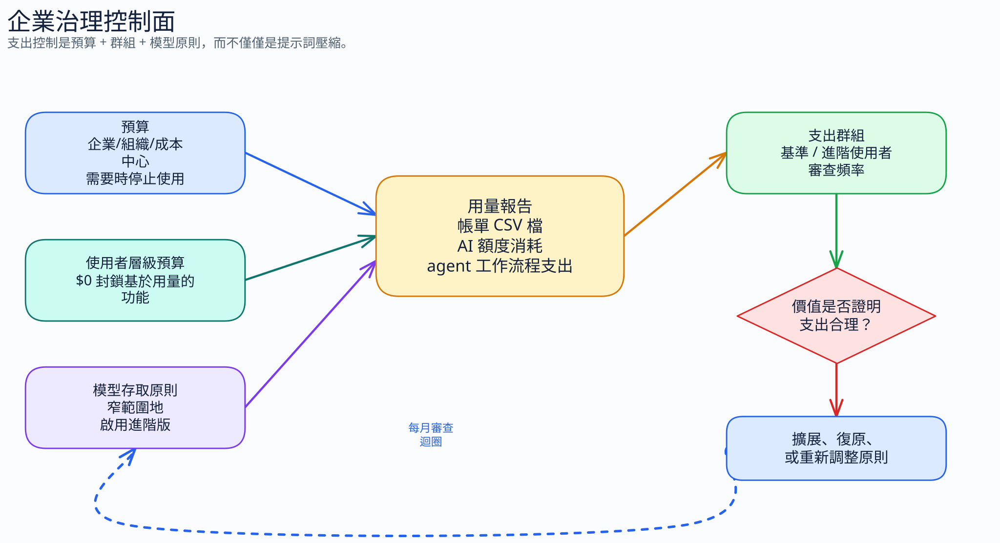

# Copilot 成本控管的企業治理

[← 返回指南](index.md)

---

請透過有文件記載的組織與企業控制項來控管 Copilot 的支出。

## 真正能控制支出的是什麼

請從以下三項開始：

1. 預算上限
2. 使用者層級的預算控制
3. 模型可用性

提示詞壓縮仍然重要，但它是提升用量效率的手段，並不是管理員的計費控制項。

對於 2026 年 6 月 1 日計費切換之後的 Business 與 Enterprise，請管理 AI 點數的用量，而不是進階請求的計數。

## 1. 先設定預算

請使用 GitHub 的[組織與企業使用量計費指引](https://docs.github.com/en/copilot/concepts/billing/usage-based-billing-for-organizations-and-enterprises)與[計量產品預算設定文件](https://docs.github.com/en/billing/how-tos/budgets/setting-up-budgets-to-control-spending-on-metered-products)。

GitHub 文件中，針對 6 月 1 日之後 Business 與 Enterprise 的重點如下：

- 預算可以設定在組織、企業或成本中心範圍
- 你可以啟用「達到預算時停止使用」
- 存在使用者層級的預算，而 **$0** 的使用者預算表示無法使用以使用量計費的功能

對於難以手動管理的預算與成本中心對應，請考慮使用 [`amgdy/copilot-finops-automation`](https://github.com/amgdy/copilot-finops-automation)。它以一份受版本控制的 YAML 檔案定義支出原則與團隊對應。GitHub Actions 會驗證該檔案、預覽變更、以冪等方式套用預算、同步成員資格，並寫出稽核與目前狀態的報告。

這讓變更可以在 pull request 中被審查，並支援排程的對帳。請使用私人儲存庫或 fork 來存放實際的設定。請勿將企業 slug、團隊、成本中心、使用者登入名稱、預算數字、報告、記錄與權杖放在公開的分支上。

預算限制的是支出；它不會減少每個提示詞的 token。

實務上的預設做法：

1. 在推行期間設定一個非零的測試預算
2. 及早啟用警示
3. 在報告看起來合理之後，啟用「停止使用」
4. 每月檢視，而不是只在超支之後才檢視

## 2. 使用使用者層級預算來逐一收緊

對於 6 月 1 日之後的 Business 與 Enterprise，乾淨的個別使用者上限，就是 GitHub [使用量計費指引](https://docs.github.com/en/copilot/concepts/billing/usage-based-billing-for-organizations-and-enterprises)中記載的**使用者層級 AI 點數預算**。GitHub 的文件明確指出，使用者層級預算為 **$0**，表示該使用者無法使用以使用量計費的功能。

請將模型選擇、聊天深度與代理程式持續時間，與每位使用者的 AI 點數預算一併檢視。

GitHub 記載了預算、成本中心、額度管理，以及組織／企業的模型存取原則。所引用的文件並未描述在單一組織內，針對 IDE 聊天任意設定「每位使用者、每個模型」的存取矩陣。個別使用者的支出限制，請使用使用者層級預算。

實務模式：

1. 基準群組取得較低的使用者層級 AI 點數預算
2. 進階使用者只有在有明確的職務需求時，才給予更多
3. 每月檢視：降低那些用量不足以支持額外成本的使用者

請根據實際支出，而非猜測，來建立群組：

1. 從 GitHub 下載歷史的 Copilot 計費或用量 CSV
2. 將 CSV 上傳至 [Copilot Billing Preview](https://copilot-billing-preview.github.com/)
3. 檢查它呈現的用量區段，例如進階使用者、高用量使用者、基準使用者與低用量使用者
4. 將這些群組對應到不同的預算預設值、檢視頻率與升級路徑

請使用這些群組，讓預算符合實際的工作。大量使用代理程式的使用者可能需要更多空間；不活躍或低價值的使用，則需要在消耗共用點數之前先檢視。

6 月 1 日之後的管理員提示：

1. 留意長時間的聊天與代理程式工作階段，因為重複的輪次現在會直接累積 AI 點數成本
2. 密切監控使用者層級的預算，因為 **$0** 會移除對以使用量計費功能的存取權
3. 請記得程式碼完成與下一個編輯建議不以 AI 點數計費，因此不要將所有 Copilot 活動視為相同成本
4. 定期檢視模型選擇，因為聊天式的互動現在會依模型與 token 消耗 AI 點數
5. 在 IDE 工作流程中保持精簡的儲存庫指示，因為即使計費方式不再依請求次數，較低的輸出量仍然會減少 AI 點數的消耗

## 3. 在啟用模型之前先審查

請使用[設定 Copilot 中 AI 模型的存取權](https://docs.github.com/en/copilot/using-github-copilot/ai-models/configuring-access-to-ai-models-in-copilot)。

GitHub 記載，組織擁有者與企業擁有者可以為成員啟用或停用對 AI 模型的存取。請將其視為受支援的模型治理控制項。

這與在單一組織內細緻調整「每位使用者的模型開關」並不相同。若需要不同的組織層級模型原則或獨立的計費界線，獨立的組織仍然可能有用。請只在該界線值得付出額外負擔時才這麼做。

實務審查檢查清單：

1. 哪些工作流程真正需要高階模型
2. 哪些團隊能從中產生可衡量的價值
3. 哪些使用者可以維持使用 Auto 或包含在內的模型
4. 啟用之後，你會檢視哪份用量報告
5. 如果支出暴增卻沒有品質提升，你會採用什麼回復規則

請分階段核准模型存取。在將存取權擴大到需要的團隊之外前，請先比較用量與輸出品質。

## 4. 讓自訂指示保持在正確的範圍

GitHub 在[為 GitHub Copilot 新增儲存庫自訂指示](https://docs.github.com/en/copilot/how-tos/configure-custom-instructions/add-repository-instructions)及其中連結的 IDE 專屬附屬頁面，記載了 IDE 與 GitHub.com 的儲存庫指示。

GitHub 在[為 GitHub Copilot 新增組織自訂指示](https://docs.github.com/en/copilot/how-tos/configure-custom-instructions/add-organization-instructions)中記載了組織指示。

GitHub 文件中的重要範圍規則：

- 儲存庫自訂指示是有效的儲存庫層級指引
- 組織自訂指示目前支援 GitHub.com 上的 Copilot Chat、GitHub.com 上的 Copilot 程式碼審查，以及 GitHub.com 上的 Copilot 雲端代理程式
- **不要**假設組織指示適用於 IDE

若要在 VS Code 或 JetBrains 中取得精簡的行為，請將指引放在儲存庫指示中，而不要只放在組織指示中。

實務上的分工：

- 組織指示：廣泛的原則語氣、審查提醒、適用於 GitHub.com 介面的跨儲存庫預設值
- 儲存庫指示：必須適用於 IDE 工作流程的具體程式碼撰寫、建構與精簡規則
- 特定路徑的指示：額外內容脈絡值回票價的狹窄本機規則

## 5. 獨立的組織可行，但請視為附帶條件的替代方案

當使用者群組已經與組織結構一致時，獨立的組織可以支援不同的模型原則或計費界線。請權衡這種區隔與以下各項：

- 更多的管理額外負擔
- 授權指派的複雜性
- 如果使用者橫跨多個組織，會顯得不便
- SCIM 與成本中心結構，可能比 Copilot 本身更能決定答案

請只在原則或計費界線足以證明這些額外負擔合理時，才使用獨立的組織。

## 6. 衡量正確的事物

請使用上述計費文件中的 GitHub 用量報告與 AI 點數報告。請詢問以下四個問題：

1. 哪些團隊最常超出基準支出
2. 哪些使用者帶來最多的 AI 點數用量
3. 哪些模型與較好的成果相關，而不只是單純的習慣
4. 哪些代理程式工作流程造成龐大的支出，卻沒有相稱的交付價值

在比較模型品質與價格定位時，補充性的基準測試會有幫助。[llm-stats.com](https://llm-stats.com/) 可作為獨立的參考點。請將它視為補充性的基準測試，**並非** GitHub 的官方指引，**也不能**取代你自己的 Copilot 用量報告。

## 7. 6 月 1 日切換檢查清單

針對 2026 年 6 月 1 日的計費模型：

1. 將管理員指引從請求計數器，轉移到 AI 點數預算
2. 在指派使用者層級或共用預算之前，先從歷史 CSV 建立支出群組
3. 決定哪些使用者需要嚴格的使用者層級預算，哪些團隊可以共用較寬鬆的共用預算
4. 在前沿模型直接成為 AI 點數支出之前，先檢視模型可用性
5. 提醒團隊，程式碼完成與下一個編輯建議仍不屬於 AI 點數計費
6. 優先留意長時間的聊天與代理程式工作流程，因為它們會成為最快放大支出的來源

## 建議的企業預設做法

1. 使用 Auto 作為預設的模型路徑
2. 在廣泛推行之前先設定預算
3. 從歷史 CSV 將使用者區分為支出群組，然後依群組調整預算預設值
4. 當需要更嚴格的個別使用者控制時，使用使用者層級的 AI 點數預算
5. 當手動編輯成本中心與預算變得有風險時，考慮採用 FinOps-as-code 自動化
6. 在啟用之前先檢視高階模型
7. 讓儲存庫指示保持精簡，使 IDE 工作流程繼承到正確的預設值
8. 只有在成本中心界線已經支持時，才使用獨立組織的區隔

---

**下一章：**[每個 Token 的成果 →](13-outcome-per-token.md)
