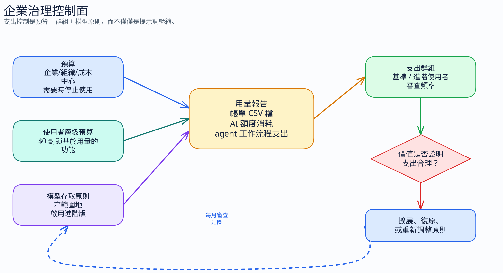

# Copilot 成本控管的企業治理

[← 回到指南](index.md)

---

透過有文件記載的組織與企業控制項來控管 Copilot 支出。

## 真正能控管支出的方式

從組織預算、使用者層級預算與模型可用性開始。

提示詞壓縮仍然重要，但它是使用效率的調節手段，而不是管理員的計費控制項。

對於 2026 年 6 月 1 日計費切換後的 Business 與 Enterprise 方案，請管理 AI 點數的用量，而非進階請求的數量。

## 1. 先設定預算

請使用 GitHub 的[組織與企業用量計費指引](https://docs.github.com/en/copilot/concepts/billing/usage-based-billing-for-organizations-and-enterprises)與[計量產品預算設定文件](https://docs.github.com/en/billing/how-tos/budgets/setting-up-budgets-to-control-spending-on-metered-products)。

GitHub 文件中針對 6 月 1 日之後的 Business 與 Enterprise 方案的重點：

- 預算可設定在組織、企業或成本中心的範圍
- 您可以啟用在達到預算時停止使用
- 存在使用者層級預算，且 **$0** 的使用者預算表示無法使用以用量計費的功能

對於難以手動管理的預算與成本中心對應，可考慮使用 [`amgdy/copilot-finops-automation`](https://github.com/amgdy/copilot-finops-automation)。以受版本控制的 YAML 檔案定義支出政策與團隊對應。GitHub Actions 會驗證該檔案、預覽變更、以冪等方式套用預算、同步成員資格，並寫入稽核與目前狀態報告。

這使變更可在 pull request 中審查，並支援排程的協調比對。請使用私人儲存庫或 fork 來存放正式設定。請勿讓企業代稱、團隊、成本中心、使用者登入名稱、預算數字、報告、記錄與權杖出現在公開分支中。

預算限制的是支出上限；並不會減少每個提示詞的 token。

實務預設做法：

1. 為推行階段設定一個非零的測試預算
2. 及早啟用警示
3. 在報告看起來合理後，啟用停止使用
4. 每月檢視，而不是只在超支後才檢視

## 2. 使用使用者層級預算進行個別收緊

依據 GitHub 的[用量計費指引](https://docs.github.com/en/copilot/concepts/billing/usage-based-billing-for-organizations-and-enterprises)，使用**使用者層級 AI 點數預算**來設定每位使用者的上限。**$0** 預算會封鎖以用量計費的功能，因此請將其視為存取權限的決定。

請將模型選擇、聊天深度與代理程式執行時間，與每位使用者的 AI 點數預算一併檢視。

GitHub 記載了預算、成本中心、額度管理，以及組織／企業的模型存取政策。所引用的文件並未描述在單一組織內，針對 IDE 聊天設定任意的每位使用者、每個模型的存取矩陣。請使用使用者層級預算來設定每位使用者的支出上限。

實務模式：

1. 基準群組取得較低的使用者層級 AI 點數預算
2. 進階使用者只有在有明確的工作需求時才取得更多
3. 每月檢視：對於用量不足以支撐額外成本的使用者降級

根據實際支出（而非臆測）建立群組：

1. 從 GitHub 下載歷史的 Copilot 計費或用量 CSV
2. 將 CSV 上傳至 [Copilot Billing Preview](https://copilot-billing-preview.github.com/)
3. 檢查它呈現的用量級距，例如進階使用者、高用量使用者、基準使用者與低用量使用者
4. 將這些群組對應到不同的預算預設值、檢視週期與升級路徑

請使用這些群組讓預算與實際工作相符。大量使用代理程式的使用者可能需要更多餘裕；閒置或低價值的使用，則需要在它消耗共用點數之前進行檢視。

請優先檢視冗長的聊天與代理程式工作階段：重複的回合會累積 AI 點數成本。程式碼完成與下一個編輯建議不以 AI 點數計費。簡潔的指示可以減少輸出，但請就其對總成本與已完成工作的影響來評判。

## 3. 啟用前先檢視模型

請參閱[在 Copilot 中設定 AI 模型的存取權限](https://docs.github.com/en/copilot/using-github-copilot/ai-models/configuring-access-to-ai-models-in-copilot)。

GitHub 記載，組織擁有者與企業擁有者可以為成員啟用或停用 AI 模型的存取權限。請將其視為受支援的模型治理控制項。

這些是組織／企業層級的控制項，而不是任意的每位使用者模型開關。當需要不同的政策或計費邊界時，第 5 節涵蓋了獨立的組織。

實務檢視檢查清單：

1. 哪些工作流程確實需要高階模型
2. 哪些團隊能從中產生可衡量的價值
3. 哪些使用者可以繼續使用 Auto 或內含的模型
4. 啟用後您將檢視哪一份用量報告
5. 如果支出暴增卻沒有品質提升，您將採用什麼回復規則

請分階段核准模型存取權限。在將存取權限擴大到需要這些模型的團隊之外前，請先比較用量與輸出品質。

## 4. 將自訂指示放在正確的範圍

GitHub 在[為 GitHub Copilot 新增儲存庫自訂指示](https://docs.github.com/en/copilot/how-tos/configure-custom-instructions/add-repository-instructions)及其連結的 IDE 專屬配套頁面中，記載了適用於 IDE 與 GitHub.com 的儲存庫指示。

GitHub 在[為 GitHub Copilot 新增組織自訂指示](https://docs.github.com/en/copilot/how-tos/configure-custom-instructions/add-organization-instructions)中記載了組織指示。

GitHub 文件中的重要範圍規則：

- 儲存庫自訂指示是有效的儲存庫層級指引
- 組織自訂指示目前支援 GitHub.com 上的 Copilot Chat、GitHub.com 上的 Copilot 程式碼審查，以及 GitHub.com 上的 Copilot 雲端代理程式
- **不要**假設組織指示適用於 IDE

若要在 VS Code 或 JetBrains 中取得精簡的行為，請將指引放在儲存庫指示中，而不只是組織指示。

實務上的劃分：

- 組織指示：廣泛的政策語氣、審查提醒、適用於 GitHub.com 介面的跨儲存庫預設值
- 儲存庫指示：必須適用於 IDE 工作流程的具體程式設計、建構與精簡規則
- 特定路徑的指示：額外上下文物有所值的局部性窄範圍規則

## 5. 權衡獨立組織與其額外負擔

當使用者群組已與組織結構相符時，獨立的組織可以支援不同的模型政策或計費邊界。請將這種分隔與下列各項權衡：

- 更多的管理負擔
- 授權指派的複雜度
- 若使用者橫跨多個組織，會不易配合
- SCIM 與成本中心結構可能比 Copilot 本身更能決定答案

只有在政策或計費邊界足以證明該額外負擔合理時，才使用獨立的組織。

## 6. 衡量正確的指標

請使用上述計費文件中的 GitHub 用量報告與 AI 點數報告。提出四個問題：

1. 哪些團隊最常超出基準支出
2. 哪些使用者帶動了最多的 AI 點數用量
3. 哪些模型與較佳的成果相關，而非僅是習慣
4. 哪些代理程式工作流程產生了大量支出，卻沒有相稱的交付價值

在比較模型品質與價格定位時，補充性的基準測試會有幫助。[llm-stats.com](https://llm-stats.com/) 可作為獨立的參考點。請將其視為補充性的基準測試，**不是** GitHub 的官方指引，也**不能**取代您自己的 Copilot 用量報告。

## 建議的企業預設做法

從 Auto 開始，在推行前設定好預算，並使用精簡的儲存庫指示。以歷史支出調整使用者層級預算，再只在成果足以證明合理的地方擴大模型存取權限。

只有在手動管理或既有的政策邊界足以證明額外負擔合理時，才加入預算自動化或獨立組織。

---

**下一篇：** [每個 Token 的成果 →](13-outcome-per-token.md)
