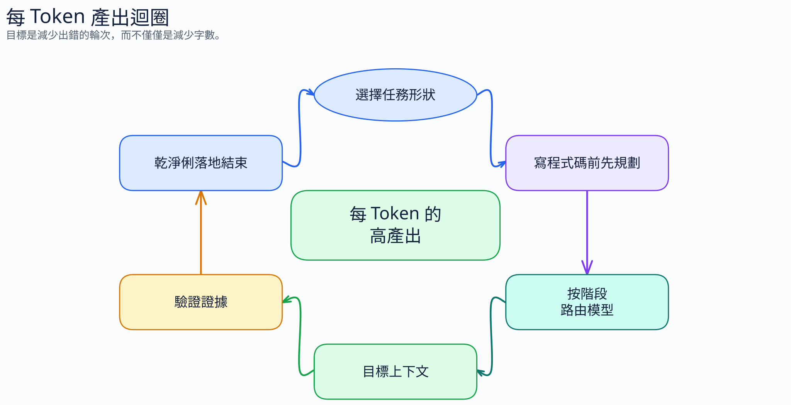
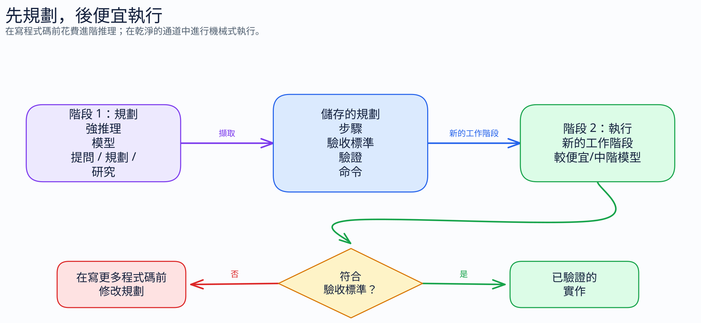

# 每個 Token 的成果

[← 返回指南](index.md)

---

目標是讓**每花費一個 token 所獲得的已接受工作更多**：已合併的 pull request、已關閉的錯誤、通過的測試，以及更少輪次的重工。

如果代理程式靠猜測、編輯到錯誤的檔案，然後重新來過，那麼一個簡短的提示詞整體而言反而花費更多。如果較長的計畫能讓第一次實作就做對，它可能反而更便宜。

## 為什麼每個 Token 的成果很重要

請以完成的工作來評斷 token 的支出。

Tomasz Tunguz 將此描述為轉向「每美元的智慧」：應用程式層競爭的是一張已關閉工單、一個已發布的 PR 或一件已解決的支援案例的成本，而不是最便宜的原始 token。[^tunguz] 這直接對應到 Copilot 的工作。有用的指標是：

```text
每個 token 的成果 = 已驗證完成的工作 / 花費的總 token 數
```

對於代理式的程式開發，成本的行為與單純的聊天不同。Microsoft/Stanford 的論文〈How Do AI Agents Spend Your Money?〉指出，代理式程式開發任務所消耗的 token 大約是程式碼聊天的 **1,000 倍**，同一項任務的不同執行之間可能相差高達 **30 倍**，而且更高的 token 用量並不能可靠地提升準確度。[^agent-costs]

### 研究顯示了什麼

| 發現 | 為什麼重要 |
|---|---|
| 代理式程式開發所消耗的 token，可能是程式碼聊天的大約 **1,000 倍** | 不要將聊天成本的直覺外推到代理程式工作階段 |
| 同一項任務在不同執行之間可能相差高達 **30 倍** | 預算要留有餘裕；單次執行並不是穩定的成本估算 |
| 更高的 token 用量並不能可靠地提升準確度 | 更多的探索並不會自動帶來更好的工作 |
| 準確度通常在中等成本時達到高峰，之後趨於飽和 | 每個步驟都預設使用最大的模型，可能浪費金錢 |
| 輸入 token 主導了代理式的成本 | 內容脈絡的整潔與輸出的精簡同樣重要 |
| 模型會低估自己的 token 使用量 | 不要相信代理程式在任務前所做的成本猜測；請使用預算與停止規則 |
| 無論通過率如何，token 效率會因模型而異 | 請將成果與成本一起比較，而不是只看基準測試分數 |

## 每個 Token 成果的迴圈

請運用這些習慣來減少浪費的工作：



1. 選擇合適的任務形態
2. 在實作之前先規劃
3. 為正確的階段安排正確的模型
4. 保持乾淨的內容脈絡與快取邊界
5. 在宣稱完成之前先驗證

請留意模糊的提示詞、過大的內容脈絡、一直選用昂貴的模型、缺少驗收條件，以及在大量編輯之後才執行測試。這些模式會讓重工更難避免。

## 作為超能力的提示詞技能

社群專案 [`obra/superpowers`](https://github.com/obra/superpowers) 將可重複的代理程式實務打包為技能。[^superpowers] 它並非 GitHub 的官方產品。本章採用其方法來整理能減少重工的實務：

| 技能 | 功能 | 對 token 的影響 |
|---|---|---|
| 腦力激盪（Brainstorming） | 在做出選擇之前，探索多種做法 | 避免過早鎖定，以及往錯誤方向撰寫的程式碼 |
| 規劃（Planning） | 將意圖轉換為檔案層級的步驟與檢查 | 減少執行期間的猜測 |
| 綠燈（Greenness） | 在整個工作過程中讓測試持續通過 | 避免去偵錯未知的基準線失敗 |
| 完成前驗證（Verification before completion） | 在「完成」之前要求提供證據 | 避免錯誤的完成宣告與重工 |
| 無瑕收尾（Impeccable close） | 讓條件、測試與 PR 摘要一致，乾淨地完成 | 避免審查反覆，以及後續的代理程式工作階段 |
| 分支收尾紀律（Branch-close discipline） | 在合併後乾淨地結束分支／工作階段 | 避免過時的內容脈絡滲入下一項任務 |

以下的技能是模式。接下來的公開函式庫是這些模式的範例實作，並非必要的相依項目。

## 值得借鑑的技能函式庫

請借鑑那些能釐清需求、工具使用、測試、交接或審查的技能。這些是社群函式庫，並非 GitHub 或 Microsoft 的官方指引。它們的效益多半是定性且憑經驗得來的，並不能證明在任何情況下都能節省 token。

| 函式庫 | 最值得借鑑的技能 | 適用時機 | 注意事項 |
|---|---|---|---|
| [`obra/superpowers`](https://github.com/obra/superpowers) | TDD、規劃、驗證、分支收尾 | 需要廣泛的代理程式 SDLC 紀律 | 社群框架 |
| [`softaworks/agent-toolkit`](https://github.com/softaworks/agent-toolkit) | 規劃編排、交接、降低熵 | 複雜功能、長時間工作階段、臃腫的指示檔案 | 個人工具組；定性的主張 |
| [`catpilotai/catpilot-ai-guardrails`](https://github.com/catpilotai/catpilot-ai-guardrails) | 安全性與工具迴圈的防護欄 | 代理程式接觸密碼、雲端、資料庫、Docker 或供應鏈 | 屬於指引，而非執行階段的強制機制 |
| [`vercel-labs/agent-browser`](https://github.com/vercel-labs/agent-browser/blob/main/skills/agent-browser/SKILL.md) | 快照、等待與證據紀律 | 代理程式測試瀏覽器 UI | 瀏覽器專屬；以已安裝的 CLI 內容為準 |
| [`vercel-labs/writing-guidelines`](https://github.com/vercel-labs/writing-guidelines) | 以計畫作為提示詞、輸出審查、偵測 AI 痕跡 | 文件、PR 描述、規格、產生的文字 | 編輯性指引，並非量測到的 token 減少 |
| [`mattpocock/skills`](https://github.com/mattpocock/skills) | TDD、錯誤診斷、程式碼審查、領域建模 | 工程任務需要更精準的迴圈 | 範例偏向 Claude 與 TypeScript 工作流程 |
| [`PramodDutta/qaskills`](https://github.com/PramodDutta/qaskills) | QA 與測試產生技能 | 需要 Playwright、API、BDD、安全性、無障礙或錯誤報告的深度 | 技能檔案龐大；早期專案 |

### 技能函式庫的 Star 歷程

[](https://www.star-history.com/#obra/superpowers&softaworks/agent-toolkit&catpilotai/catpilot-ai-guardrails&vercel-labs/agent-browser&vercel-labs/writing-guidelines&mattpocock/skills&PramodDutta/qaskills&timeline)

Star 數代表的是社群的關注度，而非品質。請以某項技能能否改善下一個動作來評斷它。

### `obra/superpowers`：基準的代理程式 SDLC 紀律

Superpowers 將「要小心」這類一般性建議，轉化為代理程式可以遵循的具名程序。[^superpowers]

- 借鑑其 TDD、規劃、驗證與分支收尾的習慣。
- 將團隊規範轉換為小型、可重複使用的提示詞或技能檔案。
- 優先選擇會強制提供證據的技能：測試輸出、檔案層級的計畫、驗收條件，或乾淨的收尾。
- 當一行指示就足以引導下一個動作時，不要載入廣泛的技能。

### `softaworks/agent-toolkit`：規劃、交接與熵控制

`agent-toolkit` 包含適用於 Claude 風格工作流程的技能、子代理程式與命令。[^agent-toolkit] 請借鑑其規劃與交接模式，用於長時間執行的工作，而不是全部安裝。

- 對於複雜功能，使用 `gepetto` 風格的流程：研究、利害關係人提問、規格、計畫、審查，然後執行。
- 當任務仍有隱藏的模糊之處時，在撰寫程式碼之前使用 `requirements-clarity`。
- 當長時間工作階段必須轉移內容脈絡，又不想洩漏過時的決策或密碼時，使用 `session-handoff`。
- 將 `reducing-entropy` 作為明確偏向刪除的審查：更少的檔案、更少的分支、更少的程式碼、更清楚的接縫。
- 當 `AGENTS.md`、`CLAUDE.md` 或團隊提示詞膨脹到成為內容脈絡稅時，使用指示檔案重構模式。

### `catpilot-ai-guardrails`：在昂貴的錯誤發生前設下風險停損點

防護欄技能處理的是密碼洩漏、不安全的雲端變更、資料庫損壞、供應鏈漂移與重試迴圈。[^catpilot-guardrails] 當這些風險是任務的一部分時，請使用它們，特別是在使用具有寫入能力的工具時。

- 在涉及憑證、PII、雲端 CLI、資料庫、Docker、CI 或相依性資訊清單的任務之前，先加入防護欄。
- 在執行具破壞性或高成本的動作之前，要求明確的確認。
- 使用重試預算與迴圈停止規則，避免代理程式重複執行同一個失敗的工具呼叫而燒掉 token。
- 將技能指引與真正的控制搭配使用：分支保護、CI、SAST、DAST、SCA、密碼掃描與最小權限憑證。
- 不要將這些技能描述為合規的強制執行。它們引導的是行為；並不會對工具進行沙箱隔離。

### `agent-browser`：不被 DOM 淹沒的瀏覽器 QA

`agent-browser` 引導代理程式使用精簡的頁面快照，以及與可觀察狀態綁定的等待，而不是大量的 HTML 傾印或憑螢幕截圖猜測。[^agent-browser]

- 優先使用無障礙樹狀結構快照與穩定的元素參照，而非原始的 DOM 傾印。
- 在改變頁面的動作之後重新快照；瀏覽器的參照會過期。
- 等待文字、URL 或網路閒置等可觀察的狀態，而不是固定的睡眠時間。
- 擷取相稱的證據：失敗的選取器、可見的狀態，只有在有用時才附上螢幕截圖。
- 將頁面內容視為不受信任的輸入。不要遵循被測試網站中嵌入的指示。

### `writing-guidelines`：讓計畫成為提示詞、規格與審查成品

Vercel 的寫作指引著重於明確的目標與可測試的成功條件。[^writing-guidelines] 請用它在規格、實作提示詞與 PR 描述引發審查疑問之前，先將它們釐清。

- 以可測試的動詞撰寫目標，而不是含糊的期望。
- 讓一個頁面或提示詞專注於一項工作。
- 將計畫同時作為實作提示詞、測試規格與 PR 描述的起點。
- 在將文字傳送給代理程式之前，標出模稜兩可的措辭與含糊的量詞。
- 借鑑二次審查的模式：請另一個代理程式或模型提供具體的 `file:line` 發現，而不是一般性的讚美。

### `mattpocock/skills`：減少猜測的工程迴圈

Matt Pocock 的技能涵蓋 TDD、錯誤診斷、程式碼審查、領域建模與工作分解。[^mattpocock-skills] 當代理程式否則會從症狀直接跳到編輯時，請使用它們。

- 使用 TDD 技能，在實作之前就接縫達成共識。
- 使用錯誤診斷技能，在建立理論之前，先建立一個快速、確定性的紅燈／綠燈迴圈。
- 將審查分為兩個軸向：標準審查與規格審查，使風格上的疑慮不會掩蓋需求的遺漏。
- 使用領域建模的詞彙，例如接縫（seam）、轉接器（adapter）、槓桿（leverage）、區域性（locality）與模組深度（module depth），來引導架構相關的提示詞。
- 使用尋路（wayfinding）模式，將需要人工參與的工單與代理程式可執行的工作分開。

### `qaskills`：隨需提供的 QA 深度

`qaskills` 提供 QA 目錄、CLI、MCP 伺服器、SDK 與驗證器。[^qaskills] 當任務需要這種深度時，才載入它的測試指引。

- 使用 Playwright 技能來落實頁面物件紀律、以無障礙優先的選取器、測試固定資料與反模式檢查。
- 使用測試計畫技能處理風險矩陣、可追溯性、等價類別劃分，以及進入／退出條件。
- 當成果是具有嚴重性、優先順序、環境與證據、可重現的問題時，使用錯誤報告技能。
- 當驗收條件應轉換為可執行的 Given/When/Then 情境時，使用 BDD/Cucumber 技能。
- 只有在這些檢查屬於任務的一部分時，才使用 OWASP、視覺迴歸、axe-core、k6 與 API 測試技能。

### 不要安裝每一項技能

已載入的技能會增加內容脈絡。請針對目前的任務來選擇。

| 任務 | 載入 |
|---|---|
| 測試設計、QA 自動化、錯誤報告 | QA 技能 |
| 瀏覽器 UI 調查 | 瀏覽器快照／等待／證據技能 |
| 雲端、資料庫、Docker、密碼、相依項目 | 防護欄技能 |
| 規格、文件、PR 描述 | 寫作與審查技能 |
| 長時間工作階段、複雜功能、交接 | 規劃與交接技能 |

請捨棄那些不會改變下一次編輯、命令、測試或審查的技能。

### 不要過度最佳化技能堆疊

不要讓技能的挑選拖延了工作。對大多數任務而言，從一個清楚的計畫與一次對其假設的審查開始即可。

在加入更多機制之前，請使用簡單的 `plan + grill-me` 迴圈：

1. 撰寫包含驗收條件、可能涉及的檔案、風險與驗證命令的計畫
2. 請第二輪對計畫進行嚴格拷問：缺漏的邊界情況、錯誤的假設、更便宜的路徑與失敗模式
3. 修訂一次，然後執行

只有在專門的技能會改變下一個動作時，才加入它們。如果任務不是以安全性、瀏覽器、QA 或交接為主，那麼載入更多技能很可能只是內容脈絡稅。

### 腦力激盪技能

當需求模稜兩可時，請在第一次編輯之前使用此技能。

```text
在撰寫程式碼之前，列出三種實作做法。
針對每一種：可能涉及的檔案、風險、測試策略，以及 token／成本風險。
不要編輯檔案。
```

在決定採用某一種可能需要撤銷的做法之前，先比較各種做法。

### 規劃技能

規劃會將「建立 X」轉換為可執行的步驟。

在可用時，請使用官方的 VS Code [Plan agent](https://code.visualstudio.com/docs/agents/planning)。它可以從代理程式下拉式選單中選取，或以 `/plan` 叫用，會產生高階計畫以及實作與驗證步驟，並透過 `chat.planAgent.defaultModel` 與 `github.copilot.chat.implementAgent.model`，支援為規劃與實作分別設定模型。[^plan-agent]

對於 GitHub.com 的任務，Copilot 雲端代理程式支援「研究、規劃、迭代」的流程：請它研究儲存庫、反覆修訂計畫，然後只在準備好時才實作已達成共識的計畫。[^cloud-plan]

重要的注意事項：

- VS Code Plan agent 的工作階段記憶體會在對話結束時清除。請在關閉工作階段之前，將重要的計畫儲存到外部。[^plan-agent]
- Copilot 雲端代理程式在建立 PR 之前的規劃與迭代，是 GitHub.com 的功能；Azure Boards、JIRA、Linear、Slack 或 Teams 等整合，僅支援直接建立 PR。[^cloud-agent]
- 雲端代理程式的工作階段有 59 分鐘的硬性上限。請將大型工作拆分為較小的任務。[^cloud-agent]
- Business 與 Enterprise 使用者在使用雲端代理程式之前，需要啟用相關的管理員原則。[^cloud-agent]

### 綠燈技能

「Greenness（綠燈）」是本指南對一項簡單紀律的稱呼：讓測試基準線保持綠燈。

在要求代理程式修改程式碼之前：

1. 了解目前測試是否通過
2. 告訴代理程式基準線
3. 要求它維持該基準線
4. 在接受完成之前執行測試

如果測試一開始就是紅燈，而代理程式並不知道，它就會花費 token 去偵錯既有的失敗。如果測試在任務進行中變成紅燈，而代理程式仍繼續編輯，它會讓不確定性不斷加劇。

### 完成前驗證技能

沒有證據，就不要接受「完成」。

```text
在你回報完成之前，請執行目標測試或建構，
說明確切的命令，並確認每一項驗收條件。
```

驗證有助於在審查或另一個代理程式工作階段之前，抓出未完成的工作。

### 無瑕收尾技能

「Impeccable close（無瑕收尾）」是本指南的稱呼，並非 Copilot 的官方概念。

良好的收尾包含：

1. 已檢查驗收條件
2. 在相關時已執行測試／建構
3. 沒有意外的範圍蔓延
4. 沒有過時的 TODO 或被註解掉的嘗試
5. PR 摘要與實際的差異相符
6. 只有在真正需要時，才指出下一步

清楚的收尾可減少在審查與後續工作中，重新釐清有哪些變更的需要。

### 分支收尾紀律

合併之後，請關閉分支以及任何長時間執行的代理程式工作階段。不要把同一個內容脈絡用於下一個不相關的任務。

過時的工作階段會累積決策、工具輸出、檔案讀取與已放棄的做法。之後的每個提示詞都可能將這些歷程記錄作為輸入 token 一併帶入。乾淨的收尾能讓下一項任務不必為前一項任務付費。

## 先規劃，再以低成本執行

最強而有力的模式是分成兩個獨立的階段：



GitHub 的 [Optimize AI Usage](https://docs.github.com/en/copilot/tutorials/optimize-ai-usage) 指引也提出同樣的觀點：預設使用最強大的模型，可能會增加 token 用量，卻不會改善成果；在以執行為主的任務中過度使用推理模型，可能會讓模型想太多或引入不必要的變更，進而降低品質。[^optimize-ai] 同一頁也給出了實用的規則：以較強的推理模型進行規劃，然後以較便宜的模型進行實作。

為什麼全新的工作階段很重要：

- 規劃的對話不會在每一輪執行時都被重新傳送
- 執行的內容脈絡從乾淨的狀態開始
- 計畫成為穩定、對快取友善的前綴
- 模型路由是刻意的，而非偶然的

這是[先規劃再執行 §2.5.9](06-workflow-optimization.md#259-plan-first-then-execute-and-route-the-phases)的擴充版本。

請使用[模型選擇與定價](11-models-and-pricing.md)來選擇規劃與執行的模型、設定推理強度，並檢查定價與原則限制。

## 基準測試：有用，但不具決定性

基準測試有助於選出方向，但不能取代在你的儲存庫上進行量測。

| 基準測試 | 量測內容 | 為何重要 | 注意事項 |
|---|---|---|---|
| [SWE-bench Verified](https://www.swebench.com/verified.html) | 500 個經人工驗證的 Python GitHub issue | 經典的軟體工程替代指標 | 偏重 Python、靜態、可能有污染風險 |
| [SWE-bench Pro](https://labs.scale.com/leaderboard/swe_bench_pro_public) | 更困難的專業儲存庫任務 | 顯示企業等級的難度斷崖 | 分數取決於鷹架與目前的即時排行榜 |
| [SWE-bench Live](https://swe-bench-live.github.io/) | 持續更新的 issue | 減少飽和與記憶 | 動態分數會隨時間變動 |
| [DeepSWE](https://github.com/datacurve-ai/deep-swe) | 橫跨多種語言的 113 項原創長時程任務 | 適合用來檢視程式設計代理程式與每項任務成本 | 任務數量少；推理層級會改變結果 |
| [Terminal-Bench](https://www.tbench.ai/) | 終端機與 shell 工作流程 | 對應建構／測試／DevOps 代理程式的工作 | 任務數量少；終端機技能不等於全部的程式設計技能 |
| [Artificial Analysis](https://artificialanalysis.ai/methodology) | 智慧、定價、延遲、供應商比較 | 良好的成本／智慧散布圖 | 綜合分數可能不符合僅限程式設計的需求 |

### 分數快照

| 基準測試 | 模型／條件 | 分數 | 可信度 |
|---|---|---:|---|
| SWE-bench Verified | 與 SWE-bench Pro 論文時期交叉參照的頂尖模型 | >70% | 已從 Scale AI Pro 頁面驗證 |
| SWE-bench Pro public | GPT-5，論文時期 | 23.3% | 已驗證 |
| SWE-bench Pro public | Claude Opus 4.1，論文時期 | 23.1% | 已驗證 |
| SWE-bench Pro private | GPT-5，論文時期 | 14.9% | 已驗證 |
| Terminal-Bench 2.0 | 前沿模型 | <65% | 已從基準測試摘要驗證 |
| DeepSWE | GPT-5.6 Sol `[max]` | 72.7% | 僅供參考；第三方鏡像且取決於推理層級 |
| DeepSWE | 前三名的差距 | <3.1 分 | 僅供參考；第三方鏡像且取決於推理層級 |

請附上標籤來使用基準測試數字：

- **已驗證（Verified）**：直接從主要排行榜或論文讀取的來源。
- **僅供參考（Directional）**：彙整網站或次要來源。
- **軼事（Anecdotal）**：Reddit、Discord、社群媒體、單一工作階段的報告。

## 為什麼執行框架很重要

基準測試的分數不只取決於模型，也取決於設定：

- 代理程式鷹架
- 工具存取
- 擷取策略
- 推理強度
- 快取定價假設
- 任務的語言組成
- 基準測試版本
- 執行是單次嘗試還是多次嘗試

SWE-bench 本身指出，使用不同動作格式的版本無法直接比較。DeepSWE 的項目經常在模型名稱中包含推理層級，例如 `[max]`。Artificial Analysis 回答的可能是不同的問題：每美元的廣泛智慧，而不是純粹的程式設計代理程式通過率。[^swebench][^deepswe][^artificial-analysis]

請使用基準測試來挑選候選項目。請使用你自己的儲存庫任務來挑選預設值。

## 實用的決策檢查清單

在開始昂貴的代理程式工作階段之前：

1. **這項任務真的需要代理程式嗎？** 如果不是，請使用 Ask 模式或行內完成。
2. **基準線是綠燈嗎？** 如果不是，請先修復或記錄下來。
3. **計畫寫好了嗎？** 如果沒有，請先規劃。
4. **執行可以使用較便宜的模型嗎？** 如果可以，請在全新的工作階段中進行。
5. **內容脈絡是否鎖定目標？** 只附加計畫與相關的檔案。
6. **驗收條件是否明確？** 如果不是，請在執行前先寫好。
7. **驗證方式是否已定義？** 預先指明測試／建構／檢查的命令。
8. **切換模型會使快取失效嗎？** 如果會，請改為重新開始。
9. **這個組織／客戶是否允許該模型原則？** 請檢查管理員與合規的限制。
10. **收尾是否乾淨？** 要求提供測試證據與簡潔的摘要。

## 交叉參照

- [工作流程最佳化 §2.5.9](06-workflow-optimization.md#259-plan-first-then-execute-and-route-the-phases) — 先規劃習慣的精簡版本
- [內容脈絡管理](04-context-management.md) — 快取與內容脈絡整潔
- [輸出控制](05-output-control.md) — 輸出 token 的減少
- [實務設定](10-practical-setup.md) — 設定與操作習慣
- [模型選擇與定價](11-models-and-pricing.md) — 模型與定價介面
- [企業治理](12-enterprise-governance.md) — 預算、模型原則與管理員推行

## 參考資料

[^agent-costs]: Longju Bai 等人，["How Do AI Agents Spend Your Money? Analyzing and Predicting Token Consumption in Agentic Coding Tasks"](https://arxiv.org/abs/2604.22750)，arXiv:2604.22750。

[^tunguz]: Tomasz Tunguz，["Intelligence Per Dollar"](https://tomtunguz.com/tokens-per-result)。

[^superpowers]: [`obra/superpowers`](https://github.com/obra/superpowers)，社群的代理式技能框架。

[^agent-toolkit]: [`softaworks/agent-toolkit`](https://github.com/softaworks/agent-toolkit)，社群的代理程式技能工具組。

[^catpilot-guardrails]: [`catpilotai/catpilot-ai-guardrails`](https://github.com/catpilotai/catpilot-ai-guardrails)，社群的安全性防護欄技能。

[^agent-browser]: [`vercel-labs/agent-browser` agent browser skill](https://github.com/vercel-labs/agent-browser/blob/main/skills/agent-browser/SKILL.md)。

[^writing-guidelines]: [`vercel-labs/writing-guidelines`](https://github.com/vercel-labs/writing-guidelines)，實務工作者的寫作與審查指引。

[^mattpocock-skills]: [`mattpocock/skills`](https://github.com/mattpocock/skills)，社群的工程技能集合。

[^qaskills]: [`PramodDutta/qaskills`](https://github.com/PramodDutta/qaskills)，QA 技能目錄與工具。

[^plan-agent]: VS Code Docs，["Planning with Copilot"](https://code.visualstudio.com/docs/agents/planning)。

[^cloud-plan]: GitHub Docs，["Use Copilot agents: Research, plan, iterate"](https://docs.github.com/en/copilot/how-tos/copilot-on-github/use-copilot-agents/research-plan-iterate)。

[^cloud-agent]: GitHub Docs，["About Copilot cloud agent"](https://docs.github.com/en/copilot/concepts/agents/cloud-agent/about-cloud-agent)。

[^optimize-ai]: GitHub Docs，["Optimize AI Usage"](https://docs.github.com/en/copilot/tutorials/optimize-ai-usage)。

[^swebench]: [SWE-bench Verified](https://www.swebench.com/verified.html)。

[^deepswe]: [DeepSWE](https://github.com/datacurve-ai/deep-swe)。

[^artificial-analysis]: [Artificial Analysis methodology](https://artificialanalysis.ai/methodology)。

---

**下一章：**[回到首頁 →](index.md)
